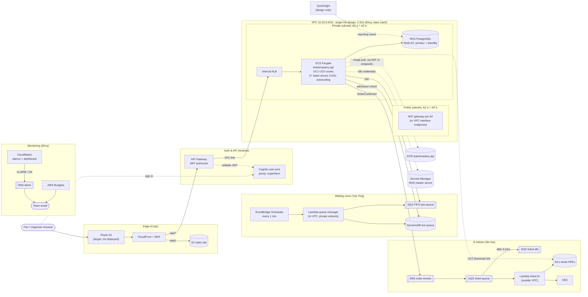
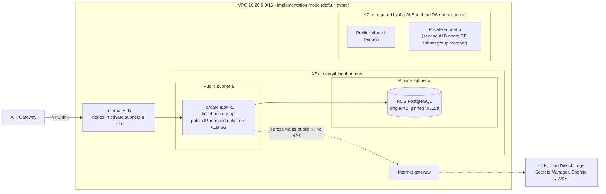

# Architecture

Region **ap-southeast-1 (Singapore)**. The network spans two Availability Zones. This page describes the **current** design, which replaces the earlier all-serverless write-up. The diagram below is the **target (HA) design** for the report. What we actually deploy is a cheaper single-AZ **implementation** of it; see [Implementation vs target (HA) design](#implementation-vs-target-ha-design).

## Summary

- **Static site**: CloudFront + WAF → S3, a static SPA built from `frontend/` (deployed on the CloudFront domain; Route 53 with a custom domain is target design only).
- **Dynamic API**: CloudFront → API Gateway HTTP API (Cognito JWT authorizer) → VPC link → **internal** Application Load Balancer in the private subnets → **one** ECS Fargate service, `ticketmastery-api` → RDS PostgreSQL in the private subnets. In the target HA design, the tasks run in the private subnets of both AZs and reach AWS APIs through a NAT gateway per AZ. In the implementation (the default `terraform.tfvars`), one task runs in the AZ a public subnet with a public IP and there is no NAT gateway.
- **One service, five modules**: `ticketmastery-api` hosts the routes for UC1–UC5, one module per use case, mounted under `/api` (`/api/concerts` for discovery, `/api/me` for account, `/api/waiting-room`, `/api/checkout`, `/api/organiser`; see `src/modules/index.ts`). `/health` sits at the root. Each use case owns its module folder and its migrations.
- **Waiting room (UC3)**: the API enqueues fans to SQS FIFO `join-queue`; the `queue-manager` Lambda assigns queue numbers in DynamoDB `live-queue`. EventBridge Scheduler runs `queue-manager` every minute (optionally limited to the sale window). Each run admits the next 500 waiting fans per concert for 15 minutes. Checkout's hold endpoint answers `403 not_admitted` until the fan's `live-queue` row is admitted.
- **E-tickets (UC4)**: an order is confirmed in RDS, then the API publishes to SNS `order-events` → SQS `ticket-queue` (DLQ `ticket-dlq` after 5 tries) → the `ticket-fn` Lambda writes the PDF to private S3 and emails it via SES. UC2 (My Tickets) hands out 5-minute pre-signed download links to that PDF.
- **Organisers (UC5)**: organisers use the same Cognito pool and are in the `organisers` group. The API checks the group before create, edit, or cancel. All seats are created in one RDS transaction. The layout locks once the sale opens. The dashboard polls every 5 s for available/held/sold counts from RDS. Reporting: five read-only SQL views in RDS (`0003_uc5_reporting_views.sql`); QuickSight on top of them is design only ([reporting.md](reporting.md)).
- **Monitoring**: `infra/modules/monitoring` creates 19 CloudWatch alarms (20 with autoscaling on) on the ALB, ECS, RDS, API Gateway, SQS, Lambda and custom `TicketMastery` metrics (waiting-room size from `queue-manager`, checkout payment failures from API log metric filters), one CloudWatch dashboard, an SNS `alerts` topic with an email subscription, and an AWS Budgets monthly cost budget (USD 80; alerts at 20/40/60/80 actual and on forecast). Messaging adds a `ticket-dlq` alarm on the same topic.
- **Seat holds (UC4)**: 10-minute, all-or-nothing holds through one atomic `UPDATE` with no double-booking. Expired holds can be reclaimed at once with `status = 'available' OR (status = 'held' AND hold_expires_at < now())`.

## Implementation vs target (HA) design

At the proposal feedback (Oct 2026; recording at about 05:56–06:57) we asked whether the implementation could use public subnets so we don't pay for a NAT gateway. The instructor's guidance: **skip the NAT gateway, use one AZ only, and don't implement HA for the implementation, but the diagram (and the report) must still show the HA design.**

So there are two modes, and the Terraform defaults build the first one:

- **Implementation (deployed; default `terraform.tfvars.example`)**: single-AZ, no NAT gateway, no HA. **One** Fargate task runs in the AZ a **public** subnet with a public IP. RDS is single-AZ and pinned to AZ a. Autoscaling is off.
- **Target HA design (diagram + report; not deployed)**: tasks spread across two AZs in **private** subnets, a NAT gateway per AZ (or VPC interface endpoints), **Multi-AZ** RDS, and autoscaling. This is the diagram above.

| Aspect | Implementation (default) | Target HA | Variable(s) to flip |
|---|---|---|---|
| Task subnets | AZ a public subnet only | Private subnets in AZ a + AZ b | `tasks_in_public_subnets = false`, `tasks_single_az = false` |
| Task egress (ECR pull, CloudWatch Logs, Secrets Manager, Cognito JWKS) | The task's own public IP, through the internet gateway | NAT gateway per AZ, or VPC interface endpoints | `enable_nat_gateway = true` + `single_nat_gateway = false`, or `enable_vpc_endpoints = true` |
| Task count | 1 task | At least 2 (one per AZ) | `desired_count = 2` |
| Scaling | Off | CPU + ALB request-count target tracking, e.g. 2–4 tasks | `enable_autoscaling = true`, `autoscaling_min_capacity = 2`, `autoscaling_max_capacity = 4` (or more) |
| Database | RDS single-AZ in AZ a, 1-day backups, no deletion protection | Multi-AZ (synchronous standby in AZ b, automatic failover), 7-day backups, deletion protection | `db_multi_az = true`, `db_backup_retention_period = 7`, `db_deletion_protection = true` |
| Inbound path and security groups | API Gateway → VPC link → internal ALB (nodes in the private subnets of both AZs) → task. `alb_sg` allows port 80 only from the VPC link's SG; `ecs_sg` allows only the container port from `alb_sg`; `rds_sg` allows only 5432 from `ecs_sg` (+ `rds_extra_ingress_sg_ids`, e.g. `queue-manager`'s SG if it ever needs RDS) | Same | None |
| Cost (ESTIMATE, whole stack) | ≈ USD 72/month | ≈ USD 194/month | See [cost-estimate.md](cost-estimate.md) |

The commented "HA / target design" block at the bottom of `infra/envs/dev/terraform.tfvars.example` has all of these values. [deploy.md](deploy.md#switching-to-the-ha-target-design) describes the switch.

**The task's public IP is not an open door.** `ecs_sg` has exactly one ingress rule (container port from `alb_sg`), so nothing on the internet can connect to the task directly. The public IP is only used for outbound calls. RDS stays in the private subnets with `publicly_accessible = false`.

**Why there are still two public and two private subnets.** An ALB (internal or internet-facing) needs subnets in at least two AZs, and an RDS DB subnet group must span at least two AZs even for a single-AZ instance. The network module therefore always creates one public and one private subnet in AZ a and AZ b. In implementation mode, the one task and the DB instance sit in AZ a. AZ b holds only the second node of the internal ALB, in private subnet b, which is also a member of the DB subnet group; public subnet b is empty. An AZ a outage therefore takes the whole API down. We accept that for the implementation, per the guidance above.

Implementation mode (what `terraform apply` builds with the defaults):

### Lambdas and the VPC (no NAT by default)

A Lambda attached to a VPC **never gets a public IP**, even in a public subnet. With no NAT gateway (the default), an in-VPC Lambda has no route to the internet or to public AWS API endpoints such as SQS, SNS, SES, Cognito, or Secrets Manager. Rules:

- Keep a Lambda **outside the VPC** unless it must reach something inside it. Outside the VPC it reaches SQS/SNS/DynamoDB/S3/SES normally.
- If a Lambda needs RDS, put it in `private_subnet_ids` with its own security group and add that SG to `rds_extra_ingress_sg_ids`. Then give it egress for exactly what it calls:
  - DynamoDB and S3: the gateway endpoints are free and already on (`enable_gateway_endpoints = true`);
  - SQS, SNS, Secrets Manager, etc.: an interface endpoint each, about USD 0.013/h per AZ per endpoint (≈ USD 9.5/month per AZ), or set `enable_nat_gateway = true` (≈ USD 43/month).

  Today `enable_vpc_endpoints` creates a fixed set (`ecr.api`, `ecr.dkr`, `logs`, `secretsmanager`, `sqs`) in both private subnets (≈ USD 95/month). If you only need one or two, override `interface_endpoint_services` in the network module call rather than turning on all five.

What the two Lambdas do:

| Lambda | Placement | What it calls, and how without NAT |
|---|---|---|
| `ticket-fn` (UC4, Node.js 22, `infra/modules/messaging`) | **Outside the VPC** | S3 (PDF + idempotency marker), SES (email), Cognito `AdminGetUser` (the fan's email), CloudWatch Logs/EMF. All are public AWS endpoints, so it stays outside the VPC; it never touches RDS (the order arrives in the SQS message). |
| `queue-manager` (UC3, Python 3.13, `infra/modules/waiting-room`) | **In the VPC**: private subnets, own SG (no inbound, HTTPS out) | DynamoDB `live-queue` only, through the free gateway endpoint. The SQS trigger is polled by the Lambda service and logs are shipped by the Lambda service, so neither needs an endpoint. The `WaitingRoomSize` metric is written as CloudWatch Embedded Metric Format in its log output, because it can't call `PutMetricData`. It doesn't use RDS, so its SG isn't in `rds_extra_ingress_sg_ids`. |

## What the stack includes

Everything below is wired into `infra/envs/dev/main.tf` and deployed to the dev account.

The base stack is Elroy's: `infra/` (`envs/dev`, `modules/{network,security,ecr,rds,ecs-service}`) and `services/ticketmastery-api/`.

| Base | Details |
|---|---|
| VPC | `10.20.0.0/16`, 2 public + 2 private subnets in 2 AZs, IGW, free S3 + DynamoDB gateway endpoints. NAT gateway optional and **off by default** (`enable_nat_gateway`; one shared or one per AZ via `single_nat_gateway`). Interface endpoints optional (off) |
| Security groups | `alb_sg` → `ecs_sg` → `rds_sg` chain; extra RDS ingress for VPC Lambdas through `rds_extra_ingress_sg_ids` |
| ECR | `ticketmastery-api` repo, scan on push, lifecycle keeps the last 10 images |
| RDS | PostgreSQL 16, `db.t4g.micro`, 20 GB gp3, **single-AZ by default**, master password managed by RDS in Secrets Manager |
| ECS | Fargate cluster, task/execution roles, task definition, internal ALB (HTTP; reached through the API Gateway VPC link) with a target group on `/health`, service with circuit-breaker rollback. Task placement via `tasks_in_public_subnets` / `tasks_single_az` (default: 1 task in the AZ a public subnet). CPU/request autoscaling optional (off by default). ECS Exec on (`enable_execute_command`), for checks against RDS from inside the VPC |
| API | Express + TypeScript, `pg`, migration runner with advisory lock, `/health`, dev-header or Cognito auth, all five use-case modules (UC1–UC5) and their migrations (`0001` UC5 schema, `0002` UC4 orders, `0003` UC5 reporting views) |
| Monitoring (`modules/monitoring`) | 19 CloudWatch alarms (20 with autoscaling), one dashboard, SNS `alerts` topic + email subscription, 2 log metric filters (checkout payment attempts/failures), AWS Budgets monthly budget (USD 80). Details: `infra/modules/monitoring/README.md` |

| Teammates' modules | Owner | Location |
|---|---|---|
| S3 site bucket, CloudFront, WAF (no Route 53: the site uses the CloudFront domain) | Cody | `infra/modules/edge/` |
| GitHub Actions OIDC deploy role for the frontend workflow | Cody (pipeline), Elroy (module) | `infra/modules/github-deploy/`, `.github/workflows/deploy-frontend.yml` |
| Cognito user pool + `organisers` group, API Gateway HTTP API + JWT authorizer + VPC link | Andrew | `infra/modules/auth-apigw/` |
| SQS FIFO `join-queue` + DLQ, DynamoDB `live-queue`, EventBridge Scheduler admit schedule, `queue-manager` | Yan Ting | `infra/modules/waiting-room/`, `lambdas/queue-manager/` |
| SNS `order-events`, SQS `ticket-queue` + DLQ, `ticket-fn`, SES sender identity, private e-ticket bucket | Shi Hui | `infra/modules/messaging/`, `lambdas/ticket-fn/` |
| UC1–UC4 API modules + migrations | Cody & Nai Xin / Andrew / Yan Ting / Shi Hui | `services/ticketmastery-api/src/modules/*` |
| Frontend SPA | Nai Xin | `frontend/` |

Not deployed: QuickSight (UC5 reporting is design only, see [instructor feedback e](#instructor-feedback-and-how-we-addressed-it) and [reporting.md](reporting.md)), Route 53, KMS customer-managed keys.

## Decision: single-AZ RDS

- **Decision**: RDS runs **single-AZ** by default (`db_multi_az = false`) and is pinned to AZ a, next to the API task. The professor confirmed single-AZ is acceptable for this project, and at the proposal feedback said HA isn't needed for the implementation at all (see [above](#implementation-vs-target-ha-design)). The report still shows Multi-AZ as the target. A Multi-AZ instance roughly doubles the instance and storage cost (see [cost-estimate.md](cost-estimate.md)).
- **Trade-off**: if AZ a fails, the database is down until AWS recovers the AZ or we restore elsewhere. In implementation mode the API task is in the same AZ, so the whole API is down too. In the HA design the tasks in AZ b would stay up, but every DB-backed route would still fail without Multi-AZ. Mitigations:
  - automated backups with point-in-time restore (`db_backup_retention_period`, default 1 day in dev);
  - restore to a new instance in the healthy AZ.

  **Measured restore (F4 drill, 31 Oct 2026):** a point-in-time restore to a new instance accepted connections 9 min 14 s after the request and reported `available` after 28 min 28 s; the restore point was 168 s before the request. Details: `docs/report/evidence/nfr8-f4-pitr.md`.
- **Flip**: set `db_multi_az = true` in `terraform.tfvars` and apply. This adds a synchronous standby in the second AZ with automatic failover, typically 60–120 s with no committed-data loss. `envs/dev` drops the AZ pin automatically (RDS rejects `availability_zone` together with `multi_az = true`, and the rds module enforces that with a precondition). Applying converts the instance in place, which can cause a brief performance impact, so do it outside a demo.
- **Two AZs are still required** even with single-AZ RDS; see [why there are still two public and two private subnets](#implementation-vs-target-ha-design).

## API Gateway → ALB integration (decided: B, VPC link)

API Gateway is the only public entry to the API; the ALB is its origin. Two options were considered:

| | A. Public ALB + `X-Origin-Verify` | B. Private (internal) ALB + VPC link |
|---|---|---|
| How | API Gateway (HTTP or REST) calls the public ALB DNS name and adds a secret header. An ALB listener rule forwards only requests carrying the header and returns 403 otherwise. The secret lives in Secrets Manager and is rotated. | The ALB becomes `internal` and API Gateway reaches it through a VPC link. The ALB is never internet-facing. |
| API type | HTTP API or REST API | **HTTP API**: its VPC link supports an ALB directly. **REST API**: its VPC link needs an **NLB** in front (NLB → ALB target), which adds about USD 18+/month plus another hop. |
| Pros | Small change: one listener rule on `alb_listener_arn` plus a default 403 action; easy to debug with `curl` | No public origin to bypass; no shared secret |
| Cons | The ALB is still reachable from the internet. The header is a shared secret, and `alb_ingress_cidrs` can't be narrowed to API Gateway IPs reliably. | Needs `internal = true` on the ALB (base-stack change) and VPC link resources in `auth-apigw`; harder to test without a bastion |

Current state: **HTTP API + VPC link (B)**. The ALB is internal (`alb_internal = true`, `alb_ingress_cidrs = []`, private subnets) and only the VPC link's security group may reach it on port 80; API Gateway integrates with `alb_listener_arn` (HTTP). A public ALB with `alb_integration = "vpc_link"` returns API Gateway 503s and fails the `auth_apigw_alb_integration` check.

## Instructor feedback and how we addressed it

Raised at the proposal feedback (Oct 2026).

| # | Feedback | What we did | Owner |
|---|---|---|---|
| a | Put **API Gateway** in front of Fargate so all APIs are managed centrally. | Done. CloudFront `/api/*` → API Gateway HTTP API (Cognito JWT authorizer, stage throttling, access logs) → VPC link → internal ALB → Fargate. The ALB has no public entry; see [API Gateway → ALB integration](#api-gateway--alb-integration-decided-b-vpc-link). | Andrew |
| b | Consider splitting the monolith into **per-feature containers / ECS services** (e.g. concert discovery/browse vs seat selection/checkout), so each has its own scaling policy and lifecycle. She said a monolith isn't wrong; it just has to scale as a whole. | Kept one service, deliberately. The module-per-use-case layout (`src/modules/<uc>/`, per-UC migrations, no cross-module imports) keeps a later split cheap: each module could become its own ECS service with its own target group behind an ALB path rule (e.g. `/api/concerts*` → discovery). That needs the `ecs-service` module to accept a shared cluster/ALB instead of creating its own. Trade-off: one scaling policy for all routes now, versus more services, target groups and deploys to run. The waiting room already shields checkout from the on-sale spike, which is the main reason to scale checkout separately. | Team; Elroy for infra |
| c | **DynamoDB** is the usual store for dynamic session data, such as live queue numbers and the 10-minute payment/hold session. Postgres is acceptable ("technically nothing wrong"). | Live queue numbers and admissions are in DynamoDB `live-queue` (UC3). Seat holds stay in Postgres on purpose: one atomic `UPDATE` in the same database as the seats and orders is what guarantees no double-booking, and the order is confirmed in the same transaction that marks the seats sold. Splitting the hold into DynamoDB would need a cross-store protocol for the same guarantee. | Yan Ting, Shi Hui |
| d | **EventBridge** running every minute costs money; check it. | Built: an EventBridge Scheduler schedule runs `queue-manager`'s admit step every minute, and it can be limited to a sale window (`admit_schedule_start_date` / `admit_schedule_end_date`) or switched off (`admit_schedule_enabled`). Every minute all month is ≈ 43,800 invocations, inside the Scheduler free tier (14 M/month) and Lambda's free 1 M requests/month; cost reasoning in `infra/modules/waiting-room/README.md`. | Yan Ting |
| e | UC5 needs **internal reporting / data statistics** for organisers, e.g. QuickSight. | Data layer built: five read-only reporting views in RDS (`0003_uc5_reporting_views.sql`: sales by concert, ticket type and day, seat status, confirmed orders), next to the live dashboard endpoint (`GET /api/organiser/concerts/:id/dashboard`). QuickSight on top is **design only** because it bills per user per month; design, pricing and setup steps in [reporting.md](reporting.md). | Elroy |

We also raised the **AWS credits** status at the feedback session.

## Decisions taken (former open questions)

| # | Question | Decision |
|---|---|---|
| 1 | E-ticket Lambda name | `ticket-fn` (`lambdas/ticket-fn/`, function `ticketmastery-dev-ticket-fn`) |
| 2 | Who frees expired holds / waiting-room slots | No sweeper. Checkout reclaims an expired hold atomically in the same `UPDATE` that takes the seat, and the seat maps count expired holds as available, so a seat is free again the moment its hold expires. Waiting-room admissions expire after 15 minutes; an expired fan who rejoins goes to the back of the queue. |
| 3 | Who owns ECR image push + ECS deploy | Manual for the API: `docker build` + push, then `image_tag` in `terraform.tfvars` and `terraform apply` ([deploy.md](deploy.md)). The frontend deploys through the GitHub Actions workflow on `main`. |
| 4 | Waiting-room store | DynamoDB `live-queue` (feedback c). |
| 5 | UC2 (My Tickets) path | Through API Gateway + Cognito authorizer like every other route; the API verifies the token again. |
| 6 | API Gateway → ALB integration | Internal ALB + HTTP API VPC link (B, above). |
| 7 | Remote Terraform state | S3 backend `ticketmastery-tfstate-000246635159` with S3-native locking (`use_lockfile`). |

## Related docs

- [deploy.md](deploy.md): first deploy, updates, teardown
- [cost-estimate.md](cost-estimate.md): monthly cost of the base stack
- [CONTRIBUTING.md](../CONTRIBUTING.md): workflow, ownership, adding routes, tables, and Terraform
- `infra/README.md`: module inputs and outputs
