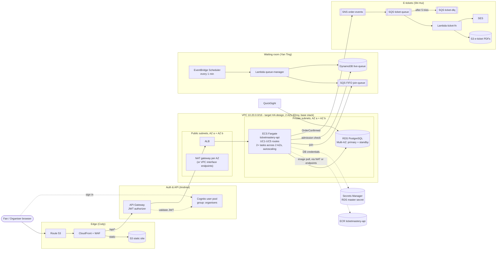
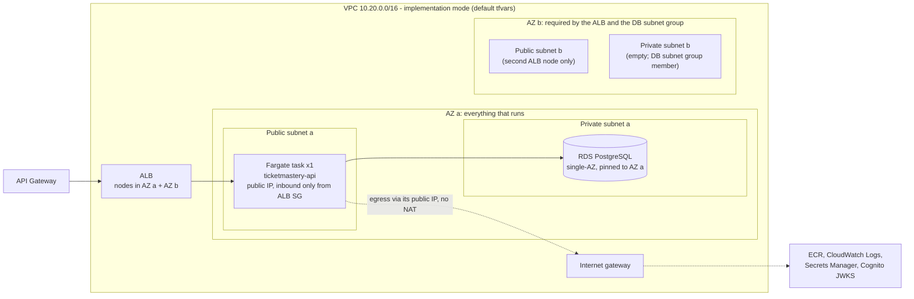

# Architecture

Region **ap-southeast-1 (Singapore)**. The network spans two Availability Zones. This page describes the **current** design, which replaces the earlier all-serverless write-up. The diagram below is the **target (HA) design** for the report. What we actually deploy is a cheaper single-AZ **implementation** of it; see [Implementation vs target (HA) design](#implementation-vs-target-ha-design).

## Summary

- **Static site**: Route 53 → CloudFront + WAF → S3, a static SPA built from `frontend/`.
- **Dynamic API**: CloudFront → API Gateway (Cognito JWT authorizer) → Application Load Balancer in the public subnets → **one** ECS Fargate service, `ticketmastery-api` → RDS PostgreSQL in the private subnets. In the target HA design, the tasks run in the private subnets of both AZs and reach AWS APIs through a NAT gateway per AZ. In the implementation (the default `terraform.tfvars`), one task runs in the AZ a public subnet with a public IP and there is no NAT gateway.
- **One service, five modules**: `ticketmastery-api` hosts the routes for UC1–UC5, one module per use case, mounted under `/api` (`/api/concerts` for discovery, `/api/me` for account, `/api/waiting-room`, `/api/checkout`, `/api/organiser`; see `src/modules/index.ts`). `/health` sits at the root. Each use case owns its module folder and its migrations.
- **Waiting room (UC3)**: the API enqueues fans to SQS FIFO `join-queue`. EventBridge Scheduler runs the `queue-manager` Lambda every minute during the sale window. Each run admits 500 fans into DynamoDB `live-queue`.
- **E-tickets (UC4)**: an order is confirmed in RDS, then the API publishes to SNS `order-events` → SQS `ticket-queue` (DLQ `ticket-dlq` after 5 tries) → the `ticket-fn` Lambda writes the PDF to private S3 and emails it via SES.
- **Organisers (UC5)**: organisers use the same Cognito pool and are in the `organisers` group. The API checks the group before create, edit, or cancel. All seats are created in one RDS transaction. The layout locks once the sale opens. The dashboard polls every 5 s for available/held/sold counts from RDS. QuickSight reads RDS for reports.
- **Seat holds (UC4)**: 10-minute, all-or-nothing holds through one atomic `UPDATE` with no double-booking. Expired holds can be reclaimed at once with `status = 'available' OR (status = 'held' AND hold_expires_at < now())`.

## Implementation vs target (HA) design

At the proposal feedback (Oct 2026; recording at about 05:56–06:57) we asked whether the implementation could use public subnets so we don't pay for a NAT gateway. The instructor's guidance: **skip the NAT gateway, use one AZ only, and don't implement HA for the implementation, but the diagram (and the report) must still show the HA design.**

So there are two modes, and the Terraform defaults build the first one:

- **Implementation (deployed; default `terraform.tfvars.example`)**: single-AZ, no NAT gateway, no HA. **One** Fargate task runs in the AZ a **public** subnet with a public IP. RDS is single-AZ and pinned to AZ a. Autoscaling is off.
- **Target HA design (diagram + report; not deployed)**: tasks spread across two AZs in **private** subnets, a NAT gateway per AZ (or VPC interface endpoints), **Multi-AZ** RDS, and autoscaling. This is the diagram above.

| Aspect | Implementation (default) | Target HA | Variable(s) to flip |
|---|---|---|---|
| Task subnets | AZ a public subnet only | Private subnets in AZ a + AZ b | `tasks_in_public_subnets = false`, `tasks_single_az = false` |
| Task egress (ECR pull, CloudWatch Logs, Secrets Manager, Cognito JWKS) | The task's own public IP, through the internet gateway | NAT gateway per AZ, or VPC interface endpoints | `enable_nat_gateway = true` + `single_nat_gateway = false`, or `enable_vpc_endpoints = true` |
| Task count | 1 task | At least 2 (one per AZ) | `desired_count = 2` |
| Scaling | Off | CPU + ALB request-count target tracking, e.g. 2–4 tasks | `enable_autoscaling = true`, `autoscaling_min_capacity = 2`, `autoscaling_max_capacity = 4` (or more) |
| Database | RDS single-AZ in AZ a, 1-day backups, no deletion protection | Multi-AZ (synchronous standby in AZ b, automatic failover), 7-day backups, deletion protection | `db_multi_az = true`, `db_backup_retention_period = 7`, `db_deletion_protection = true` |
| Inbound path and security groups | API Gateway → ALB (nodes in both AZs) → task. `ecs_sg` allows only the container port from `alb_sg`; `rds_sg` allows only 5432 from `ecs_sg` (+ `rds_extra_ingress_sg_ids`) | Same | None |
| Cost (ESTIMATE) | ≈ USD 69/month | ≈ USD 190/month | See [cost-estimate.md](cost-estimate.md) |

The commented "HA / target design" block at the bottom of `infra/envs/dev/terraform.tfvars.example` has all of these values. [deploy.md](deploy.md#switching-to-the-ha-target-design) describes the switch.

**The task's public IP is not an open door.** `ecs_sg` has exactly one ingress rule (container port from `alb_sg`), so nothing on the internet can connect to the task directly. The public IP is only used for outbound calls. RDS stays in the private subnets with `publicly_accessible = false`.

**Why there are still two public and two private subnets.** An internet-facing ALB needs subnets in at least two AZs, and an RDS DB subnet group must span at least two AZs even for a single-AZ instance. The network module therefore always creates one public and one private subnet in AZ a and AZ b. In implementation mode, everything that runs (the one task and the DB instance) sits in AZ a. AZ b holds only the second ALB node, plus an empty private subnet that belongs to the DB subnet group. An AZ a outage therefore takes the whole API down. We accept that for the implementation, per the guidance above.

Implementation mode (what `terraform apply` builds with the defaults):

### Lambdas and the VPC (no NAT by default)

A Lambda attached to a VPC **never gets a public IP**, even in a public subnet. With no NAT gateway (the default), an in-VPC Lambda has no route to the internet or to public AWS API endpoints such as SQS, SNS, SES, or Secrets Manager. So:

- Keep `queue-manager` and `ticket-fn` **outside the VPC** unless they must reach RDS. Outside the VPC they reach SQS/SNS/DynamoDB/S3/SES normally.
- If a Lambda needs RDS, put it in `private_subnet_ids` with its own security group and add that SG to `rds_extra_ingress_sg_ids`. Then give it egress for exactly what it calls:
  - DynamoDB and S3: the gateway endpoints are free and already on (`enable_gateway_endpoints = true`);
  - SQS, SNS, Secrets Manager, etc.: an interface endpoint each, about USD 0.013/h per AZ per endpoint (≈ USD 9.5/month per AZ), or set `enable_nat_gateway = true` (≈ USD 43/month).

  Today `enable_vpc_endpoints` creates a fixed set (`ecr.api`, `ecr.dkr`, `logs`, `secretsmanager`, `sqs`) in both private subnets (≈ USD 95/month). If you only need one or two, override `interface_endpoint_services` in the network module call rather than turning on all five.

## What this base stack includes

The base stack is Elroy's. Its code is in `infra/` (`envs/dev`, `modules/{network,security,ecr,rds,ecs-service}`) and `services/ticketmastery-api/`.

| Included | Details |
|---|---|
| VPC | `10.20.0.0/16`, 2 public + 2 private subnets in 2 AZs, IGW, free S3 + DynamoDB gateway endpoints. NAT gateway optional and **off by default** (`enable_nat_gateway`; one shared or one per AZ via `single_nat_gateway`). Interface endpoints optional (off) |
| Security groups | `alb_sg` → `ecs_sg` → `rds_sg` chain; extra RDS ingress for VPC Lambdas through `rds_extra_ingress_sg_ids` |
| ECR | `ticketmastery-api` repo, scan on push, lifecycle keeps the last 10 images |
| RDS | PostgreSQL 16, `db.t4g.micro`, 20 GB gp3, **single-AZ by default**, master password managed by RDS in Secrets Manager |
| ECS | Fargate cluster, task/execution roles, task definition, ALB (HTTP, or HTTPS when `certificate_arn` is set) with a target group on `/health`, service with circuit-breaker rollback. Task placement via `tasks_in_public_subnets` / `tasks_single_az` (default: 1 task in the AZ a public subnet). CPU/request autoscaling optional (off by default) |
| API skeleton | Express + TypeScript, `pg`, migration runner with advisory lock, `/health`, dev-header auth stub, UC5 organiser module and schema |

| Not included (teammates' modules) | Owner | Planned location |
|---|---|---|
| S3 site bucket, CloudFront, WAF, Route 53, deploy pipeline | Cody | `infra/modules/edge/` |
| Cognito user pool + groups, API Gateway + authorizer | Andrew | `infra/modules/auth-apigw/` |
| SQS FIFO `join-queue`, DynamoDB `live-queue`, Scheduler, `queue-manager` | Yan Ting | `infra/modules/waiting-room/`, `lambdas/queue-manager/` |
| SNS `order-events`, SQS `ticket-queue` + DLQ, `ticket-fn`, SES, PDF bucket | Shi Hui | `infra/modules/messaging/`, `lambdas/ticket-fn/` |
| UC1–UC4 API modules + migrations | Cody & Nai Xin / Andrew / Yan Ting / Shi Hui | `services/ticketmastery-api/src/modules/*` |
| Frontend SPA | Nai Xin | `frontend/` |
| QuickSight (UC5 reporting; [instructor feedback e](#instructor-feedback-open-items-not-implemented)) | Elroy | not in Terraform yet |

## Decision: single-AZ RDS

- **Decision**: RDS runs **single-AZ** by default (`db_multi_az = false`) and is pinned to AZ a, next to the API task. The professor confirmed single-AZ is acceptable for this project, and at the proposal feedback said HA isn't needed for the implementation at all (see [above](#implementation-vs-target-ha-design)). The report still shows Multi-AZ as the target. A Multi-AZ instance roughly doubles the instance and storage cost (see [cost-estimate.md](cost-estimate.md)).
- **Trade-off**: if AZ a fails, the database is down until AWS recovers the AZ or we restore elsewhere. In implementation mode the API task is in the same AZ, so the whole API is down too. In the HA design the tasks in AZ b would stay up, but every DB-backed route would still fail without Multi-AZ. Mitigations:
  - automated backups with point-in-time restore (`db_backup_retention_period`, default 1 day in dev);
  - restore to a new instance in the healthy AZ.

  **RTO is TBC.** We haven't measured how long a restore takes.
- **Flip**: set `db_multi_az = true` in `terraform.tfvars` and apply. This adds a synchronous standby in the second AZ with automatic failover, typically 60–120 s with no committed-data loss. `envs/dev` drops the AZ pin automatically (RDS rejects `availability_zone` together with `multi_az = true`, and the rds module enforces that with a precondition). Applying converts the instance in place, which can cause a brief performance impact, so do it outside a demo.
- **Two AZs are still required** even with single-AZ RDS; see [why there are still two public and two private subnets](#implementation-vs-target-ha-design).

## API Gateway → ALB integration (decided: B, VPC link)

API Gateway is the only public entry to the API; the ALB is its origin. Two options were considered:

| | A. Public ALB + `X-Origin-Verify` | B. Private (internal) ALB + VPC link |
|---|---|---|
| How | API Gateway (HTTP or REST) calls the public ALB DNS name and adds a secret header. An ALB listener rule forwards only requests carrying the header and returns 403 otherwise. The secret lives in Secrets Manager and is rotated. | The ALB becomes `internal` and API Gateway reaches it through a VPC link. The ALB is never internet-facing. |
| API type | HTTP API or REST API | **HTTP API**: its VPC link supports an ALB directly. **REST API**: its VPC link needs an **NLB** in front (NLB → ALB target), which adds about USD 18+/month plus another hop. |
| Pros | Small change: one listener rule on `alb_listener_arn` plus a default 403 action; easy to debug with `curl` | No public origin to bypass; no shared secret |
| Cons | The ALB is still reachable from the internet. The header is a shared secret, and `alb_ingress_cidrs` can't be narrowed to API Gateway IPs reliably. | Needs `internal = true` on the ALB (base-stack change) and VPC link resources in `auth-apigw`; harder to test without a bastion |

Current state: **HTTP API + VPC link (B)**. The ALB is internal (`alb_internal = true`, `alb_ingress_cidrs = []`, private subnets) and only the VPC link's security group may reach it on port 80; API Gateway integrates with `alb_listener_arn` (HTTP). A public ALB with `alb_integration = "vpc_link"` returns API Gateway 503s and fails the `auth_apigw_alb_integration` check.

## Instructor feedback (open items, not implemented)

Raised at the proposal feedback (Oct 2026). None of these are implemented in this branch.

| # | Feedback | Our position / next step | Owner |
|---|---|---|---|
| a | Put **API Gateway** in front of Fargate so all APIs are managed centrally. | Already planned (CloudFront → API Gateway → ALB). Still to confirm how API Gateway integrates with the ALB; see [API Gateway → ALB integration](#api-gateway--alb-integration-open-andrew-to-decide). | Andrew |
| b | Consider splitting the monolith into **per-feature containers / ECS services** (e.g. concert discovery/browse vs seat selection/checkout), so each has its own scaling policy and lifecycle. She said a monolith isn't wrong; it just has to scale as a whole. | Keep one service for now. The module-per-use-case layout (`src/modules/<uc>/`, per-UC migrations, no cross-module imports) makes a later split cheap: each module could become its own ECS service with its own target group behind an ALB path rule (e.g. `/api/concerts*` → discovery). That needs the `ecs-service` module to accept a shared cluster/ALB instead of creating its own. Mention the trade-off in the report. | Team; Elroy for infra |
| c | **DynamoDB** is the usual store for dynamic session data, such as live queue numbers and the 10-minute payment/hold session. Postgres is acceptable ("technically nothing wrong"). | Live queue state is already planned in DynamoDB `live-queue`. Seat holds are in Postgres on purpose: one atomic `UPDATE` in the same database as the seats and orders is what guarantees no double-booking. The team must decide and justify this in the report (see also [open question 4](#open-questions)). | Yan Ting, Shi Hui |
| d | **EventBridge** running every minute costs money; check it. | EventBridge Scheduler: 14 M invocations/month free, then ≈ USD 1 per million. A per-minute schedule is ≈ 43,800 invocations/month (60 × 24 × 30.4), plus the same number of `queue-manager` Lambda invocations, which fits in Lambda's free 1 M requests/month at small memory/duration. ESTIMATE: ≈ USD 0 at our scale, but verify. Either way, **scope schedules to the sale window** (schedule start/end dates, or enable only during on-sale) instead of running 24/7. | Yan Ting |
| e | UC5 needs **internal reporting / data statistics** for organisers, e.g. QuickSight. | The live dashboard endpoint (`GET /api/organiser/concerts/:id/dashboard`) is the base. A QuickSight dashboard on RDS is still to do. QuickSight is billed **per user per month** (authors cost more than readers), so keep the user count minimal and check current pricing first. Reading RDS in the private subnets needs a QuickSight VPC connection whose SG is added to `rds_extra_ingress_sg_ids`. | Elroy |

We also raised the **AWS credits** status: the credits have **not been received yet**.

## Open questions

| # | Question | Options | Who decides |
|---|---|---|---|
| 1 | E-ticket Lambda name | `ticket-fn` (README, CODEOWNERS) vs `ticket-worker` | Shi Hui |
| 2 | Who frees expired holds / waiting-room slots | `queue-manager` does it vs separate `wr-release-fn` + `hold-sweeper-fn` vs none (checkout reclaims expired holds atomically; a sweeper only tidies counts) | Yan Ting + Shi Hui |
| 3 | Who owns ECR image push + ECS deploy | Cody's pipeline (CI builds, pushes, and runs `update-service`) vs Elroy (manual `docker push` + `terraform apply` / `--force-new-deployment`) | Cody + Elroy |
| 4 | Waiting-room store | DynamoDB `live-queue` (current plan; serverless, scales with the spike; also what the instructor suggested, see [feedback c](#instructor-feedback-open-items-not-implemented)) vs an RDS queue table (one fewer service, but adds write load on the single DB during on-sale) | Yan Ting |
| 5 | UC2 (My Tickets) path | Through API Gateway + Cognito authorizer like the other routes vs CloudFront → ALB directly (JWT verified in the API) | Andrew |
| 6 | API Gateway → ALB integration | Public ALB + `X-Origin-Verify` vs internal ALB + HTTP API VPC link (see above) | Andrew |
| 7 | Remote Terraform state | Local state with one applier vs S3 backend (+ DynamoDB lock or `use_lockfile`) | Cody (account owner) |

## Related docs

- [deploy.md](deploy.md): first deploy, updates, teardown
- [cost-estimate.md](cost-estimate.md): monthly cost of the base stack
- [CONTRIBUTING.md](../CONTRIBUTING.md): workflow, ownership, adding routes, tables, and Terraform
- `infra/README.md`: module inputs and outputs
