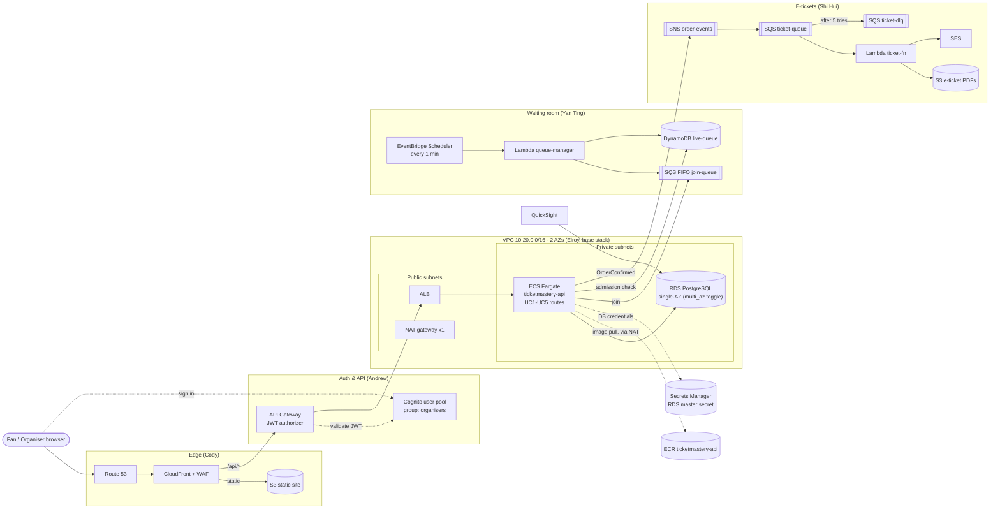

# Architecture

Region **ap-southeast-1 (Singapore)**, two Availability Zones. This page describes the **current** design, which replaces the earlier all-serverless write-up.

## Summary

- **Static site**: Route 53 → CloudFront + WAF → S3, a static SPA built from `frontend/`.
- **Dynamic API**: CloudFront → API Gateway (Cognito JWT authorizer) → Application Load Balancer in the public subnets → **one** ECS Fargate service, `ticketmastery-api`, in the private subnets of both AZs → RDS PostgreSQL in the private subnets.
- **One service, five modules**: `ticketmastery-api` hosts the routes for UC1–UC5, one module per use case, mounted under `/api` (`/api/concerts` for discovery, `/api/me` for account, `/api/waiting-room`, `/api/checkout`, `/api/organiser`; see `src/modules/index.ts`). `/health` sits at the root. Each use case owns its module folder and its migrations.
- **Waiting room (UC3)**: the API enqueues fans to SQS FIFO `join-queue`. EventBridge Scheduler runs the `queue-manager` Lambda every minute during the sale window. Each run admits 500 fans into DynamoDB `live-queue`.
- **E-tickets (UC4)**: an order is confirmed in RDS, then the API publishes to SNS `order-events` → SQS `ticket-queue` (DLQ `ticket-dlq` after 5 tries) → the `ticket-fn` Lambda writes the PDF to private S3 and emails it via SES.
- **Organisers (UC5)**: organisers use the same Cognito pool and are in the `organisers` group. The API checks the group before create, edit, or cancel. All seats are created in one RDS transaction. The layout locks once the sale opens. The dashboard polls every 5 s for available/held/sold counts from RDS. QuickSight reads RDS for reports.
- **Seat holds (UC4)**: 10-minute, all-or-nothing holds through one atomic `UPDATE` with no double-booking. Expired holds can be reclaimed at once with `status = 'available' OR (status = 'held' AND hold_expires_at < now())`.

## What this base stack includes

The base stack is Elroy's. Its code is in `infra/` (`envs/dev`, `modules/{network,security,ecr,rds,ecs-service}`) and `services/ticketmastery-api/`.

| Included | Details |
|---|---|
| VPC | `10.20.0.0/16`, 2 public + 2 private subnets in 2 AZs, IGW, **one** NAT gateway (`single_nat_gateway`), free S3 + DynamoDB gateway endpoints; interface endpoints optional (off) |
| Security groups | `alb_sg` → `ecs_sg` → `rds_sg` chain; extra RDS ingress for VPC Lambdas through `rds_extra_ingress_sg_ids` |
| ECR | `ticketmastery-api` repo, scan on push, lifecycle keeps the last 10 images |
| RDS | PostgreSQL 16, `db.t4g.micro`, 20 GB gp3, **single-AZ by default**, master password managed by RDS in Secrets Manager |
| ECS | Fargate cluster, task/execution roles, task definition, ALB (HTTP, or HTTPS when `certificate_arn` is set) with a target group on `/health`, service with circuit-breaker rollback, CPU/request autoscaling (1–4 tasks) |
| API skeleton | Express + TypeScript, `pg`, migration runner with advisory lock, `/health`, dev-header auth stub, UC5 organiser module and schema |

| Not included (teammates' modules) | Owner | Planned location |
|---|---|---|
| S3 site bucket, CloudFront, WAF, Route 53, deploy pipeline | Cody | `infra/modules/edge/` |
| Cognito user pool + groups, API Gateway + authorizer | Andrew | `infra/modules/auth-apigw/` |
| SQS FIFO `join-queue`, DynamoDB `live-queue`, Scheduler, `queue-manager` | Yan Ting | `infra/modules/waiting-room/`, `lambdas/queue-manager/` |
| SNS `order-events`, SQS `ticket-queue` + DLQ, `ticket-fn`, SES, PDF bucket | Shi Hui | `infra/modules/messaging/`, `lambdas/ticket-fn/` |
| UC1–UC4 API modules + migrations | Cody & Nai Xin / Andrew / Yan Ting / Shi Hui | `services/ticketmastery-api/src/modules/*` |
| Frontend SPA | Nai Xin | `frontend/` |
| QuickSight | TBC | not in Terraform yet |

## Decision: single-AZ RDS

- **Decision**: RDS runs **single-AZ** by default (`db_multi_az = false`). The professor confirmed single-AZ is acceptable for this project. A Multi-AZ instance roughly doubles the instance and storage cost (see [cost-estimate.md](cost-estimate.md)).
- **Trade-off**: if the database's AZ fails, the database is down until AWS recovers the AZ or we restore elsewhere. The ECS tasks in the other AZ stay up, but every DB-backed route fails. Mitigations:
  - automated backups with point-in-time restore (`db_backup_retention_period`, default 1 day in dev);
  - restore to a new instance in the healthy AZ.

  **RTO is TBC.** We haven't measured how long a restore takes.
- **Flip**: set `db_multi_az = true` in `terraform.tfvars` and apply. This adds a synchronous standby in the second AZ with automatic failover, typically 60–120 s with no committed-data loss. Applying converts the instance in place, which can cause a brief performance impact, so do it outside a demo.
- **Two AZs are still required** even with single-AZ RDS. An ALB needs subnets in at least two AZs, and an RDS DB subnet group must span at least two AZs. The network module always creates two of each.

## API Gateway → ALB integration (open, Andrew to decide)

The ALB lives in the public subnets today and is the origin for API Gateway. Two options:

| | A. Public ALB + `X-Origin-Verify` | B. Private (internal) ALB + VPC link |
|---|---|---|
| How | API Gateway (HTTP or REST) calls the public ALB DNS name and adds a secret header. An ALB listener rule forwards only requests carrying the header and returns 403 otherwise. The secret lives in Secrets Manager and is rotated. | The ALB becomes `internal` and API Gateway reaches it through a VPC link. The ALB is never internet-facing. |
| API type | HTTP API or REST API | **HTTP API**: its VPC link supports an ALB directly. **REST API**: its VPC link needs an **NLB** in front (NLB → ALB target), which adds about USD 18+/month plus another hop. |
| Pros | Small change: one listener rule on `alb_listener_arn` plus a default 403 action; easy to debug with `curl` | No public origin to bypass; no shared secret |
| Cons | The ALB is still reachable from the internet. The header is a shared secret, and `alb_ingress_cidrs` can't be narrowed to API Gateway IPs reliably. | Needs `internal = true` on the ALB (base-stack change) and VPC link resources in `auth-apigw`; harder to test without a bastion |

Current state: the ALB is public (`internal = false`, `alb_ingress_cidrs = ["0.0.0.0/0"]`), and no `X-Origin-Verify` listener rule exists yet. Option **A** fits as-is, once someone adds the header rule and the secret. If Andrew picks **HTTP API + VPC link (B)**, Elroy will make the ALB internal. `alb_listener_arn`, which the integration needs, is already an output.

## Open questions

| # | Question | Options | Who decides |
|---|---|---|---|
| 1 | E-ticket Lambda name | `ticket-fn` (README, CODEOWNERS) vs `ticket-worker` | Shi Hui |
| 2 | Who frees expired holds / waiting-room slots | `queue-manager` does it vs separate `wr-release-fn` + `hold-sweeper-fn` vs none (checkout reclaims expired holds atomically; a sweeper only tidies counts) | Yan Ting + Shi Hui |
| 3 | Who owns ECR image push + ECS deploy | Cody's pipeline (CI builds, pushes, and runs `update-service`) vs Elroy (manual `docker push` + `terraform apply` / `--force-new-deployment`) | Cody + Elroy |
| 4 | Waiting-room store | DynamoDB `live-queue` (current plan; serverless, scales with the spike) vs an RDS queue table (one fewer service, but adds write load on the single DB during on-sale) | Yan Ting |
| 5 | UC2 (My Tickets) path | Through API Gateway + Cognito authorizer like the other routes vs CloudFront → ALB directly (JWT verified in the API) | Andrew |
| 6 | API Gateway → ALB integration | Public ALB + `X-Origin-Verify` vs internal ALB + HTTP API VPC link (see above) | Andrew |
| 7 | Remote Terraform state | Local state with one applier vs S3 backend (+ DynamoDB lock or `use_lockfile`) | Cody (account owner) |

## Related docs

- [deploy.md](deploy.md): first deploy, updates, teardown
- [cost-estimate.md](cost-estimate.md): monthly cost of the base stack
- [CONTRIBUTING.md](../CONTRIBUTING.md): workflow, ownership, adding routes, tables, and Terraform
- `infra/README.md`: module inputs and outputs
