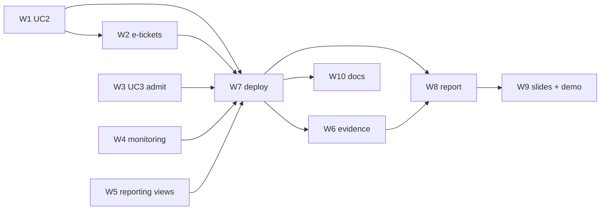

# Final submission: goal and implementation plan

**Integration owner:** Elroy · **Branch:** `feat/final-integration` (one branch for all remaining work) ·
**Deadline:** Tue 10 Nov 2026 19:00 SGT (final report and presentation) · **Contact email** (SES sender, alerts,
Budgets): `tayelroy@gmail.com`

Course deliverables (IS458 Project Specification): final presentation (20 min, 8%), final report (5–20 pages, 15%),
peer evaluation (3%, individual). Assessment criteria: feasibility; resources allocated with justification; linkage
of resources; overall design and implementation; **monitoring and alerts**; scalability and availability;
management approach.

## Goal

Submission is done when all of these hold:

1. **All five use cases work live on AWS** through the CloudFront URL, signed in with Cognito:
   UC1 browse → UC3 join the waiting room and get admitted → UC4 hold seats and pay → UC2 see the ticket and
   download its PDF, and receive the e-ticket email → UC5 organiser creates, publishes and cancels a concert and sees
   live counts; sales reporting views exist in RDS, and QuickSight is described as a design-only extension.
2. **Monitoring and alerts are deployed** in Terraform: a CloudWatch dashboard, alarms for every row of the
   proposal's monitoring table that applies to the built stack, alert emails through SNS, and AWS Budgets at
   USD 20/40/60/80.
3. **Every NFR has evidence** (numbers, logs or screenshots under `docs/report/evidence/`), or the report states
   why it is design-only (multi-AZ and region loss in implementation mode).
4. **The final report** (`docs/report/report.md`, exported to DOCX and PDF, 5–20 pages) covers each assessment
   criterion, with the HA target design and the single-AZ implementation both shown.
5. **The slide outline and speaker notes** for the 20-minute presentation are in `docs/report/slides.md`, together
   with a rehearsed live-demo script.
6. `main` contains everything, deployed from `main`; the README status tables and docs match what is deployed.

## Status (1 Nov 2026, 10:00 UTC)

| # | Status | Notes |
|---|---|---|
| W1 UC2 | Done | PR #19 merged into `feat/final-integration` with Andrew's later fixes (seat order, PDF check, coverage); Cognito attribute fix applied and smoke-tested (email change pending until verified; `phone_number` write rejected) |
| W2 e-tickets | Done | `ticket-fn` live; first live run exposed a missing `ses:SendRawEmail` permission, fixed and re-tested (NFR-7) |
| W3 UC3 admit | Done | Admit schedule live; checkout enforces admission |
| W4 monitoring | Done | 19 alarms + dashboard + Budgets; alarms fired during the burst test; email delivery tested |
| W5 reporting | Done | Views live; QuickSight design only (`docs/reporting.md`) |
| W6 evidence | Done | NFR-1–11 measured; results in `docs/report/evidence/` |
| W7 deploy | Done | API image `d1bd6e8` (+ `ticket-fn` fix), frontend redeployed; stack live on CloudFront |
| W8 report | Done | `docs/report/report.md` → `report.pdf` (19 pages) and `report.docx` |
| W9 slides + demo | Outline done | `slides.md` (21 slides, 19.75 min) and `demo-script.md`; the team lays out the Canva deck and rehearses |
| W10 docs | Done | Status tables, architecture decisions, cost estimate (whole stack ≈ USD 72/month) |

Left for the team: review and merge the integration PR (CODEOWNERS approvals); lay out the slides in Canva and
rehearse the demo (`demo-script.md`: verify the demo fans' emails in SES first); peer evaluation (individual);
`terraform destroy` after the presentation.

## Starting point (checked 2026-10-31)

| Area | State |
|---|---|
| Live stack | CloudFront `/api/concerts` returns JSON; API Gateway `/health` 200; 1 ECS task (task def :6) |
| UC1 discovery | Merged (#10), live |
| UC2 account | Cognito sign-in merged (#18); My Tickets PR #19 open, changes requested; Cognito attribute fix on this branch |
| UC3 waiting room | SQS FIFO, DynamoDB `live-queue`, `queue-manager` (assigns positions) deployed; join API merged (#14). **Missing:** admit step in `queue-manager`, EventBridge schedule, and checkout's `isAdmitted` (always `true`) |
| UC4 checkout | Holds, confirm, `OrderConfirmed` → SNS → SQS `ticket-queue` (+ DLQ) deployed. **Missing:** `ticket-fn`, e-ticket bucket, SES |
| UC5 organiser | Implemented. **Missing:** QuickSight reporting |
| Monitoring | One alarm (`ticket-dlq-not-empty`), no actions. **Missing:** dashboard, alarms, alert emails, Budgets |
| Evidence | **Missing:** load test, oversell check, hold-expiry check, failure/restore drills |
| Report / slides | Proposal deck (Canva, 24 slides) and the old all-serverless write-up exist; **no final report or deck** |

## Workstreams

| # | Workstream | Done when | Depends on | Needs from you |
|---|---|---|---|---|
| W1 | **UC2 finish**: merge Andrew's `feat/uc2-my-account` into this branch (keeps his commits); seat order `length(seat_number), seat_number` + a test with seats 2 and 10; README note that `test:coverage` needs `DB_HOST`; Cognito attribute fix (already here, see [cognito-email-verify.md](cognito-email-verify.md)) | API tests pass against Postgres; PR #19 closed as folded in | Docker running (Postgres) | Tell Andrew |
| W2 | **E-ticket pipeline**: `lambdas/ticket-fn` (Node 20, outside the VPC) on SQS `ticket-queue`, partial batch failures; renders the PDF and writes `tickets/<orderId>.pdf` with `If-None-Match: *` so a retry never emails twice; looks up the fan's email in Cognito by `sub`; sends through SES. Terraform in `modules/messaging`: private bucket, Lambda + event source mapping, IAM, SES identity, API task role `s3:GetObject` on `tickets/*`, `TICKET_PDF_BUCKET` via `extra_environment` | A test purchase produces the PDF in S3, the email, and a working Download button | W1 | Sender address for SES; click the SES verification emails (sandbox: sender and each demo recipient); tell Shi Hui |
| W3 | **UC3 admit**: `queue-manager` handles the scheduled event by admitting the next 500 `WAITING` fans per concert (status `ADMITTED`, 15-minute expiry); `aws_scheduler_schedule` every minute, limited to the sale window; checkout's `isAdmitted` reads `live-queue` | A fan in the queue is admitted within a minute of the sale opening, and a fan who isn't admitted gets `403` on hold | — | Tell Yan Ting and Shi Hui |
| W4 | **Monitoring and alerts**: new `modules/monitoring`: SNS `alerts` topic + email subscription; alarms on ALB p95 latency > 300 ms, 5xx > 1 %, unhealthy hosts, ECS CPU/memory, RDS CPU > 75 %, connections, free storage, `ticket-queue` oldest message > 60 s, DLQ > 0, Lambda errors (`queue-manager`, `ticket-fn`), API Gateway 5xx, waiting-room size (custom metric from `queue-manager`); one CloudWatch dashboard; AWS Budgets at USD 20/40/60/80 | `terraform apply` creates them; one alarm forced into `ALARM` delivers an email | — | Alert email address; confirm the SNS subscription email |
| W5 | **Reporting (UC5), design only**: reporting views in a new `0003_uc5_reporting_views.sql` (sales by concert, ticket type and day; seat status counts) that a BI tool reads; the report describes QuickSight Enterprise with a VPC connection to RDS as the design, with cost, and why it isn't deployed (per-user billing) | Views return the demo concert's sales | — | — |
| W6 | **NFR evidence**: k6 scripts in `loadtest/`: browse p95/p99 (NFR-1), 10× burst with autoscaling switched on for the test (NFR-2), many fans racing for the same seats + the oversell SQL check (NFR-3), hold expiry (NFR-4), waiting-room order (NFR-6), e-ticket delay from SQS metrics (NFR-7); drills: stop the ECS task and time recovery (F1), RDS point-in-time restore timed (F4, NFR-8/9), deleted afterwards | Results and screenshots in `docs/report/evidence/` | W2–W4 deployed | OK to run load against the live stack; WAF rate limits may need the test IP allowed for the run |
| W7 | **Deploy**: build the API image (`linux/amd64`), push to ECR, `terraform plan -out tfplan` + `apply`, build and deploy the frontend (workflow runs on `main`), smoke test every use case on CloudFront | Demo script passes end to end on the CloudFront URL | W1–W4 merged | Tell the team before applying (Cody owns the account) |
| W8 | **Report**: `docs/report/report.md` → DOCX and PDF (pandoc): context and business goals; requirements, use cases, NFRs; architecture (HA target + implementation, updated diagram replacing the serverless draw.io); resource allocation and justification; linkage; scalability and availability; monitoring and alerts; management (IaC, CI/CD, branching, cost, security, DR); evidence; instructor feedback and how we responded; limitations and future work | 5–20 pages, every criterion has a section | W6 for numbers | Report template or formatting rules, if any |
| W9 | **Slides + demo script**: `docs/report/slides.md` (slide-by-slide outline, speaker notes, owner per section) and `docs/report/demo-script.md` | 20-minute run-through fits | W7, W8 | Lay out the slides in Canva |
| W10 | **Docs and cleanup**: service README status table (UC1 and UC3 still say stub), `architecture.md` feedback statuses, cost estimate with real numbers, `src/modules/stub.ts` removed once unused | Docs match what is deployed | W1–W7 | — |

Peer evaluation is individual; each member submits their own.

## Order

W1–W4 are independent code changes and run in parallel; W8's sections that don't need numbers are drafted in
parallel too. Everything is committed on `feat/final-integration`, then merged to `main` with a **merge commit**
(not squash), so each teammate keeps authorship of their commits.

## Risks

| Risk | Mitigation |
|---|---|
| Late integration leaves no time for evidence | W1–W4 and W7 first (working demo), then W6 evidence, then the report; report sections that don't need numbers are drafted in parallel |
| SES sandbox only sends to verified addresses | Verify the demo recipients; the report states production access as a go-live step |
| QuickSight would cost per user per month | Design only (decided 2026-10-31); reporting views make it a console-only step later |
| Load test hits WAF rate limits or the single task | Allow the test IP for the run; enable autoscaling (max 3) only for the burst test, then switch it off |
| Changing modules owned by teammates | Each owner is told; their commits are kept by merging (not squashing) |
| Live demo fails on the day | Rehearse with the demo script; keep a screen recording as a fallback |
