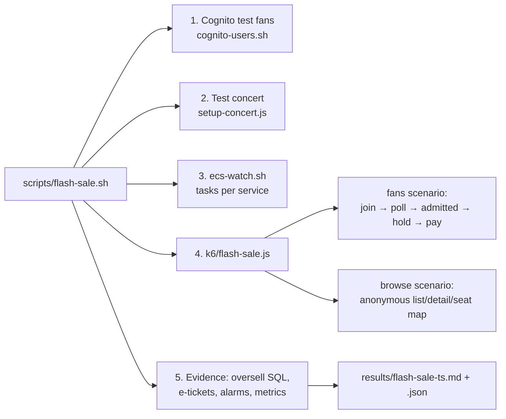

# Flash-sale simulation: plan

**Goal.** Rehearse a real on-sale end to end on the live dev stack: a crowd of signed-in fans arrives at once, queues,
is admitted in batches, competes for a limited set of seats, pays (some declines and abandons), and gets e-tickets,
while anonymous browsing spikes in parallel. One run measures, in one report, what the separate NFR tests measured
one at a time: no seat sold twice (NFR-3), fair admission (NFR-6), e-ticket delivery (NFR-7), per-service scaling
(NFR-2), throttling, database connections and which alarms fired.

**Why it matters for the project.** It's the scenario the whole design exists for ("100,000 fans in the first
minutes"). It turns the capacity paragraph in report §2.2 into a measurement, and gives the presentation one
before/after story: what the waiting room absorbs, what the API throttles, and what scales.

## What it runs

Each fan (one k6 VU) does what the web app does:

1. **Arrives** in a front-loaded wave over `ARRIVAL_SEC` (most in the first third), opens the concert page.
2. **Joins** the waiting room and **polls** `GET …/status` every `POLL_SEC` (5 s, like the page). `BACKOFF=1` adds
   jittered exponential backoff on `429`, the production fix proposed in report §2.2; `BACKOFF=0` is today's page.
3. When **admitted**, reads the checkout seat map and picks 1–3 seats (weighted 25/55/20 %; a fan buys at most 3 seats per order), biased to the front
   rows so fans compete for the same seats.
4. **Holds** them; on `409 seats_unavailable` refreshes and retries (up to `MAX_ATTEMPTS`); stops on sold out.
5. **Thinks** for a few seconds, then **pays**: `PAY_FAIL_RATE` are declined (the fan tries again), `ABANDON_RATE`
   release the hold and leave.
6. Logs one `FANRESULT` JSON line: outcome, seats, queue position, time to admission, time to order, 429s seen.

The browse scenario runs `BROWSE_RPS` anonymous requests per second against the public concert routes during the
sale, so the run also shows that browsing load scales `discovery` and not `checkout`.

## Profiles

| Profile | Fans | Seats | Demand / supply | Browse | Expected duration | What it shows |
|---|---|---|---|---|---|---|
| `smoke` | 40 | 30 | ≈ 2.6× | 5 req/s | ≈ 7 min | The script works end to end |
| `standard` | 400 | 300 | ≈ 2.9× | 20 req/s | ≈ 12 min | A sell-out under contention; polling ≈ 80 req/s stays under the 100 req/s throttle |
| `peak` | 999 | 400 | ≈ 5× | 20 req/s | ≈ 15 min | Two admit batches (500/min); polling ≈ 200 req/s exceeds the throttle, so `429`s appear: run once with `BACKOFF=0`, once with `BACKOFF=1` |

999 is the most `cognito-users.sh` creates. Every value is an environment variable, so a profile is only a default.

## Pass criteria

| Check | Source | Pass |
|---|---|---|
| No seat sold twice | `nfr3-oversell-check.sh` (SQL inside the VPC) | 0 seats in two confirmed orders, sold seats = order lines |
| Sold out cleanly | seat map after the run | sold + held ≤ seats; every fan ends with an outcome, none with a 5xx |
| Fair admission | `FANRESULT` positions vs admission times | 0 fans admitted in a later batch than someone behind them |
| No server errors | k6 | 0 responses ≥ 500 (429s are counted apart: they're the throttle working) |
| E-tickets | `nfr7-eticket.sh` over the run | every paid order emailed; p95 reported (the SES sandbox sends 1 email/s, so a big sale is expected to exceed 60 s and fire the NFR-7 alarm: that's a finding, not a test failure) |
| Scaling | `ecs-watch.sh` | report max tasks per service |
| Database | CloudWatch `DatabaseConnections` max | below `max_connections` (≈ 80); `rds-connections-high` (> 64) is the warning |

## Safety

- **Never against the demo concert.** The script creates its own concert and only touches load-test users
  (`success+lt…@simulator.amazonses.com`).
- **Email.** Mailbox-simulator mail does not count toward the SES daily quota (200/day) but is limited by the send
  rate (1/s), so the real demo inbox is unaffected
  ([AWS docs](https://docs.aws.amazon.com/ses/latest/dg/send-an-email-from-console.html)).
- **Timing.** Not within 2 hours of the presentation: alarms email the team, services scale out and take a few
  minutes to scale back in. Best on 8 Nov after the dress rehearsal, or before it.
- **Throttle.** The `peak` profile pushes the API Gateway stage to its 100 req/s limit, so anyone else using the site
  during that run gets `429`s too.
- **Database connections.** With three services at their autoscaling maximum (3 tasks × 10 connections each) plus the
  rest, connections can approach `max_connections`. The preflight prints the live value; watch the alarm.
- **Cost.** A few minutes of extra Fargate tasks, Lambda and SQS: well under USD 1 per run [estimate].
- **Cleanup.** The test concert is cancelled on every exit, including after an error, so it never stays in the public
  listing (`KEEP_CONCERT=1` keeps it). `CLEANUP=1` also deletes the test users; without it they are kept for a rerun
  within the 60-minute token lifetime.
- **Sleep.** A run takes 5–20 minutes. If the computer sleeps mid-run every fan pauses (seen in testing: 8 minutes
  with no requests, then fans timing out), so keep it awake and plugged in while a run is going.

## Steps

1. `aws login --profile ticketmastery`.
2. `cd loadtest && PROFILE=smoke scripts/flash-sale.sh`: check the report in `results/flash-sale-*.md`.
3. `PROFILE=standard scripts/flash-sale.sh` for the evidence run.
4. Optional: `PROFILE=peak BACKOFF=0` and then `PROFILE=peak BACKOFF=1 FAN_OFFSET=0` (new concert each time).
5. Copy the curated result into `docs/report/evidence/` and add one row to report §10 and one bullet to slide 15.

## First run (7 Nov 2026, `smoke`)

40 fans for 30 seats, browsing at 5 req/s: **all checks PASS**. 13 orders sold all 30 seats. This run predates the 1–3 seats per order rule: an order then held 1–4
seats (1 order of 1 seat, 9 of 2, 1 of 3, 2 of 4 = 30); the SQL check agrees: 13 confirmed orders, 30 seats in them,
30 seats sold, 0 seats in two orders. 26 fans found it sold out, 1 abandoned; 25 lost seat races (409); 0 5xx, 0 429. Arrival to admission
p95 53 s (one admit run a minute), arrival to order p95 52 s; hold p95 286 ms. 13 e-tickets, p95 6 s. Peak 9 RDS
connections of `max_connections` **79** (the live value, read by the preflight); no service scaled and no alarm
fired at this size. Report: `loadtest/results/flash-sale-20261107T021752Z.md`.

## Files

| File | Role |
|---|---|
| `loadtest/k6/flash-sale.js` | The fans and browse scenarios; one `FANRESULT` line per fan; k6 summary |
| `loadtest/scripts/flash-sale.sh` | Profiles, preflight, users, concert, ECS watch, k6, evidence, report, cleanup |
