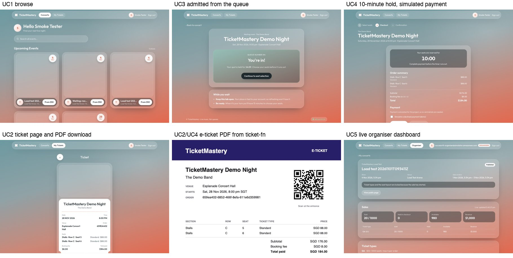

```{=typst}
#show table: set text(size: 8pt)
#show raw: set text(size: 8pt)
```

<!-- Export from docs/report/: pandoc report.md --lua-filter colwidths.lua --pdf-engine=typst -o report.pdf
     (and -o report.docx). Measured numbers come from evidence/; everything else from the repo docs. -->

# 1. Executive summary

TicketMastery is a Singapore-based B2C platform where fans across Asia-Pacific buy concert tickets. It falls under the
course's *Online Shopping System* theme. Ticket sales are spiky: a popular on-sale can bring 50,000–100,000 concurrent
fans in its first minutes, about 10× normal load. The platform must stay up during that spike and must never sell a
seat twice.

The stack runs in ap-southeast-1 (Singapore):

- **Front end:** CloudFront and WAF serve the React single-page app from S3 and forward `/api/*` to an API Gateway
  HTTP API.
- **API:** API Gateway checks Cognito tokens and reaches an internal Application Load Balancer through a VPC link.
  Behind the ALB, one ECS Fargate service (`ticketmastery-api`) hosts all five use cases. Concerts, seats and orders
  are stored in RDS PostgreSQL.

Two event-driven parts sit beside the request path:

- **Virtual waiting room:** SQS FIFO, DynamoDB, and the `queue-manager` Lambda run every minute by EventBridge
  Scheduler. It admits 500 fans per concert per minute, so the spike never reaches the database at once.
- **E-ticket pipeline:** SNS → SQS → the `ticket-fn` Lambda → S3 and SES. It keeps PDF rendering and email off the
  checkout path.

**No seat is ever sold twice**, because a seat hold is one all-or-nothing SQL `UPDATE` in the same database as the
seats and orders.

The report presents two designs, both built from the same Terraform; a block of variables switches between them:

- **Target high-availability (HA) design:** two AZs, private subnets with a NAT gateway per AZ, autoscaling 2–4+
  tasks, Multi-AZ RDS; ≈ USD 194/month for the whole stack.
- **Implementation mode:** what the instructor asked us to deploy at the proposal review. One AZ, no NAT gateway,
  one task, single-AZ RDS; ≈ USD 72/month for the whole stack (≈ 62 of it the base stack).

Section 3 shows both diagrams. Section 7 says which availability targets are therefore design-only.

Operations are managed as code:

- Terraform modules with shared S3 remote state and locking;
- a GitHub Actions deploy for the frontend over OIDC;
- review routed by CODEOWNERS;
- 20 CloudWatch alarms and a dashboard, alerting by email through SNS;
- AWS Budgets at USD 20/40/60/80;
- k6 tests and failure drills for every NFR.

# 2. Business context and requirements

## 2.1 Context, users and goal

TicketMastery has three kinds of user (Google Doc, *Customer Base*):

- **Guests** browse concerts without signing in.
- **Fans** (registered users) join waiting rooms, buy tickets and download e-tickets.
- **Organisers** (internal staff, Cognito group `organisers`) create concerts, ticket types and seat layouts, and
  watch sales live.

The business goal (Google Doc): fans buy tickets *"without the platform buckling under traffic spikes, with every seat
sold to exactly one buyer"*. Checkout stays secure, e-tickets arrive within seconds, and organisers see pricing,
inventory and sales in real time.

## 2.2 Base requirement and traffic model

The specification's base requirement for this theme: *the company covers Asia-Pacific; 80% of its customers are from
Singapore; the remainder are split evenly between Malaysia, Thailand and Hong Kong.*

During the proposal we drafted a different split (Google Doc, *Traffic model*): Singapore 60%, Malaysia 20%,
Indonesia/Thailand/Philippines 15%, rest of APAC 5%. It was labelled "team assumption, to confirm". **This report
uses the specification's split**, because that is the base requirement we are assessed against.

| Origin | Share | How it is served |
|---|---|---|
| Singapore | 80% | CloudFront edge in Singapore; API in ap-southeast-1 |
| Malaysia, Thailand, Hong Kong | ≈ 6.7% each | CloudFront edge in-country; dynamic calls cross the AWS backbone to Singapore |

The design conclusion is the same under either split: one region plus CloudFront edges is enough. Our earlier
serverless write-up estimated round trips from Singapore of about 10 ms to Kuala Lumpur and 30–40 ms to Bangkok and
Hong Kong, well inside the 300 ms p95 target. The distribution uses `PriceClass_200`, which has edge locations in all
four markets.

Load assumptions for one major on-sale (Google Doc):

| Phase | Concurrent users | Absorbed by |
|---|---|---|
| Normal day | ≈ 5,000 | CloudFront for static content; ALB and the minimum number of tasks for the API |
| First 10 minutes of a major on-sale | 50,000–100,000 | The waiting room queues them, CloudFront serves the waiting page, and 500 per concert are admitted each minute |

## 2.3 Use cases and functional requirements

The proposal listed ten fan, two admin and six system use cases. We grouped them into five deliverable use cases.
Each is one API module and one frontend folder, with one owner:

| UC | Name | Owner | Functional requirements |
|---|---|---|---|
| UC1 | Concert discovery | Cody, Nai Xin | FR-1 list published concerts, with search (`q`, artist, venue) and date filters; detail with ticket types, prices and availability. FR-2 seat map showing available, held and sold seats (an expired hold shows as available) |
| UC2 | My Tickets & Account | Andrew | FR-3 sign up, sign in and sign out with Cognito (email verification). FR-4 list the fan's confirmed orders, open an e-ticket, download its PDF through a short-lived link |
| UC3 | Virtual waiting room | Yan Ting | FR-5 join, see the queue position, be admitted in arrival order in batches. FR-6 only admitted fans may hold seats; admission lasts 15 minutes |
| UC4 | Seat selection & checkout | Shi Hui | FR-7 hold 1–20 seats for 10 minutes, all or nothing, one active hold per fan per concert. FR-8 simulated payment: success sells the seats, failure or timeout releases them. FR-9 email the e-ticket PDF after payment |
| UC5 | Concert & ticket management | Elroy | FR-10 create, edit, publish and cancel concerts; ticket types and seat layout, locked once the sale opens; cancelling emails every ticket holder. FR-11 live available, held and sold counts and revenue. FR-12 sales reporting for a BI tool |

The six system use cases (autoscaling, flash-sale queue, monitoring, caching, load balancing, failure handling) are
covered in Sections 7 and 8. Payment is simulated: the proposal scoped real payment as design-only.

## 2.4 Non-functional requirements

These are the proposal's NFRs (Google Doc). Section 10 has the method and the result for each one.

| # | Category | Target |
|---|---|---|
| NFR-1 | Performance | Browse and seat-map APIs: p95 < 300 ms, p99 < 800 ms at baseline |
| NFR-2 | Scalability | Sustain 10× baseline; scale-out within 5 min; 0 dropped requests at the admitted rate |
| NFR-3 | Correctness | 0 oversold seats across all tests |
| NFR-4 | Hold accuracy | Seat available again within 30 s of hold expiry |
| NFR-5 | Availability | 99.9% monthly for the purchase path; no outage on the loss of one instance or one AZ |
| NFR-6 | Fairness | Admission order matches queue order |
| NFR-7 | Delivery | 95% of e-ticket emails sent within 60 s of payment |
| NFR-8 | RPO | Paid orders: 0 on AZ loss; ≤ 30 min on data corruption; ≤ 24 h on region loss |
| NFR-9 | RTO | AZ loss ≤ 5 min; data corruption ≤ 1 h; region loss ≤ 4 h (design only) |
| NFR-10 | Security | HTTPS on public paths; encryption at rest; DB only in private subnets |
| NFR-11 | Cost | Total project spend under USD 80 |

# 3. Architecture

## 3.1 From the serverless proposal to containers and RDS

Our first write-up was all-serverless: API Gateway REST and WebSocket APIs, one Lambda per module, and DynamoDB for
concerts, seats and orders. Much of its reasoning still holds, and we kept it:

- one region with CloudFront for APAC;
- WAF on the single public entry point;
- SQS FIFO for the queue;
- SNS/SQS fan-out to idempotent consumers;
- Cognito for sign-in.

We moved the core to **ECS Fargate + RDS PostgreSQL** for four reasons.

1. **Correctness is easier to prove in SQL.** A hold is one conditional `UPDATE` with a row-count check. Confirming,
   cancelling and locking the layout are each one transaction, guarded by foreign keys, check constraints and
   triggers. In DynamoDB the same guarantees need careful single-table design, `TransactWriteItems` is capped at 100
   items, and reporting needs exports.
2. **Organiser reporting is relational.** Sales by concert, ticket type and day are SQL views (Section 6.5).
3. **It covers the course's infrastructure topics.** The serverless design had nothing to put in a VPC, so it showed
   no subnets, security-group chains, load balancer, container autoscaling or Multi-AZ failover.
4. **The cost is predictable at our scale**, and the API is TypeScript like the frontend.

We kept serverless where it fits best:

- **The waiting room**, because DynamoDB absorbs the spike without loading the single database; it was also the
  instructor's suggestion.
- **The asynchronous e-ticket worker.**

The trade-off is that containers and RDS cost money while idle and scale more slowly than Lambda. The waiting room
makes that acceptable, because it caps how many buyers reach the API.

## 3.2 Target HA design

{width=100%}

- **Edge.** Route 53 → CloudFront (`PriceClass_200`, redirect to HTTPS) with a WAF web ACL: the AWS managed common
  rule set plus an IP rate rule at 2,000 requests per 5 minutes. The SPA comes from a private S3 bucket through
  Origin Access Control (OAC). `/api/*` and `/health` go to API Gateway.
- **API front door.** API Gateway HTTP API.
  - `GET /api/concerts…` and `GET /health` are public. Every other `/api/*` route, the waiting room included, needs a
    Cognito access token (JWT authorizer).
  - The stage throttles at 100 rps steady and 200 burst, and writes JSON access logs.
  - A **VPC link** reaches an **internal** ALB, so the ALB is never internet-facing.
- **Compute.** One ECS Fargate service (Node 20, Express, TypeScript): at least two tasks, one per AZ, in private
  subnets, with CPU and request-count autoscaling. Egress goes through a NAT gateway per AZ (or interface endpoints).
- **Data.** RDS PostgreSQL 16 Multi-AZ (synchronous standby, automatic failover), 7-day point-in-time recovery,
  deletion protection, encrypted storage. RDS manages the master password in Secrets Manager.
- **Waiting room.** SQS FIFO `join-queue` → `queue-manager` (Python 3.13, in the VPC) → DynamoDB `live-queue`.
  EventBridge Scheduler (`rate(1 minute)`) runs the admit step.
- **E-tickets.** SNS `order-events` → SQS `ticket-queue` (DLQ after 5 receives) → `ticket-fn` (Node.js 22, arm64,
  outside the VPC) → S3 `tickets/<orderId>.pdf` + SES.
- **Operations.** CloudWatch alarms and a dashboard → SNS `alerts` → email. AWS Budgets. QuickSight over a VPC
  connection for reporting (design only, Section 12).

## 3.3 Implementation mode (deployed)

At the proposal review the instructor asked us to **skip the NAT gateway, use one AZ and not implement HA, but still
show the HA design**. The Terraform defaults build exactly that.

{width=100%}

| Aspect | Implementation (deployed) | Target HA | Variable(s) |
|---|---|---|---|
| Task subnets | AZ a public subnet; public IP used only for egress | Private subnets, AZ a + b | `tasks_in_public_subnets`, `tasks_single_az` |
| Task egress | Own public IP via the internet gateway | NAT per AZ or interface endpoints | `enable_nat_gateway`, `single_nat_gateway`, `enable_vpc_endpoints` |
| Tasks / scaling | 1 task, autoscaling off (on only for the burst test) | ≥ 2 tasks, autoscaling 2–4+ | `desired_count`, `enable_autoscaling`, `autoscaling_*_capacity` |
| Database | Single-AZ, pinned to AZ a, 1-day backups | Multi-AZ, 7-day backups, deletion protection | `db_multi_az`, `db_backup_retention_period`, `db_deletion_protection` |
| Cost (estimate, whole stack) | ≈ USD 72/month | ≈ USD 194/month | `docs/cost-estimate.md` |

- **The task's public IP is not an open door.** The task security group has one ingress rule: the container port,
  from the ALB security group. RDS stays private (`publicly_accessible = false`).
- **Why there are still two subnets of each kind.** An ALB needs subnets in two AZs, and an RDS subnet group must
  span two AZs. In implementation mode AZ b holds only the second ALB node and an empty member of the DB subnet group.
- **Lambdas and the VPC.** A Lambda attached to a VPC never gets a public IP, so with no NAT it reaches only what the
  free S3 and DynamoDB gateway endpoints cover.
  - `ticket-fn` needs SQS, S3, SES and Cognito, so it runs **outside** the VPC.
  - `queue-manager` runs in the private subnets. Its SQS input arrives through an event source mapping (the Lambda
    service polls the queue), it writes DynamoDB through the gateway endpoint, and it publishes its metric as a log
    line in CloudWatch Embedded Metric Format (EMF), because it cannot call the CloudWatch API.

# 4. Resource allocation and justification

The table sizes the implementation mode. Prices are on-demand list prices for ap-southeast-1 at 730 h/month, from
`docs/cost-estimate.md` and the module READMEs. They are estimates, not bills.

| Layer | Service and configuration | Justification | ≈ USD/month |
|---|---|---|---|
| Edge | CloudFront `PriceClass_200`; SPA cached 1 day (hashed assets 1 year) | Cheapest price class with edges in SG, MY, TH and HK; TLS close to fans; absorbs browse traffic | per request |
| Edge security | WAF: AWS common rules + IP rate limit 2,000 / 5 min (3 rules) | Blocks exploits and single-source floods before they reach the API | ≈ 8 (5 per ACL + 1 per rule) |
| Static site | Private S3 + OAC | No servers for static content | < 1 |
| Identity | Cognito user pool, `organisers` group, email verification | Managed sign-in; JWTs that API Gateway validates | free tier |
| API front door | API Gateway HTTP API, JWT authorizer, VPC link, throttle 100 rps / 200 burst | Central API management (instructor feedback a). Auth before compute. An HTTP API's VPC link targets an ALB directly; a REST API would need an extra NLB (≈ 18+). The throttle is sized to protect one 0.25 vCPU task | per request |
| Load balancer | Internal ALB, health check `/health` (runs DB `SELECT 1`) | Spreads requests over tasks and AZs; takes unhealthy tasks out | 24.2 |
| Compute | Fargate, 1 × 0.25 vCPU / 0.5 GB, x86_64. Autoscaling targets: CPU 60%, 500 requests per task per minute | No servers to patch; per-second billing. Smallest size; the burst test checks scale-out | 11.3 |
| Public IPv4 | Task × 1 (the ALB is internal, so it has none) | Replaces a NAT gateway (≈ 43 per AZ) | 3.65 |
| Database | RDS PostgreSQL 16 `db.t4g.micro`, 20 GB gp3, encrypted, single-AZ | Transactions for zero double-booking; relational reporting. Smallest Graviton class | 18.3 + 2.8 |
| Secrets, registry, logs | Secrets Manager (RDS-managed secret); ECR (scan on push, keep 10 images); CloudWatch Logs (14 days) | No password in code or state; private images; central logs | 0.4 + 0.1 + ≈ 1 |
| Waiting room | SQS FIFO `join-queue` (DLQ after 3 tries); DynamoDB `live-queue` (on-demand, TTL); `queue-manager` (128 MB, 30 s, SQS batch 10); Scheduler `rate(1 minute)` | FIFO keeps arrival order per concert. DynamoDB scales with the spike without loading RDS. 43,800 runs/month fit the Scheduler (14 M) and Lambda (1 M) free tiers | ≈ 0 |
| E-tickets | SNS → SQS `ticket-queue` (visibility 6 × the 60 s timeout, DLQ after 5, DLQ kept 14 days) → `ticket-fn` (Node.js 22 arm64, 256 MB, batch 10, max concurrency 2) → private S3 + SES | Checkout doesn't wait for the PDF or the email. Concurrency 2 respects the SES sandbox rate of 1 email/s | ≈ 0 |
| Monitoring | 19 alarms in `modules/monitoring` (20 with autoscaling) + the DLQ alarm in `messaging` = 23 alarm metrics; 1 dashboard; 4 custom metrics; SNS email; Budgets | Section 8 | ≈ 1.3 (10 alarm metrics and 10 custom metrics free; dashboard free) |
| **Whole stack** | | | **≈ 72** (≈ 62 base stack + WAF ≈ 8 + monitoring and pay-per-request ≈ 2; ≈ 2.4/day) |

The target HA design is **≈ USD 194/month** (≈ 6.4/day; Appendix B). The extra cost is two NAT gateways with their
Elastic IPs (≈ 94), Multi-AZ RDS (≈ +21) and a second task (≈ +11), minus the task's public IP.

Alternatives we rejected:

- **A NAT gateway in implementation mode.** It would have been the largest single line item.
- **ElastiCache for seat holds** (proposal). A hold in Redis and an order in RDS are two systems that can disagree;
  one SQL `UPDATE` cannot.
- **QuickSight.** Billed per user per month, so it stays design-only (Section 12).

# 5. Linkage of resources

## 5.1 Request path per use case

| UC | Path |
|---|---|
| Static | Browser → CloudFront (+ WAF) → S3 via OAC; a CloudFront function rewrites SPA routes to `index.html` |
| UC1 | CloudFront `/api/concerts…` → API Gateway public route → VPC link → internal ALB → Fargate `discovery` → RDS |
| UC2 | Cognito sign-in (access token) → CloudFront → API Gateway (JWT) → ALB → `account` → RDS. Download: the API sends `HeadObject` to S3 for `tickets/<orderId>.pdf` and returns a 300 s pre-signed `GetObject` URL; the browser downloads straight from S3 |
| UC3 | `POST /join` → API → SQS FIFO (`MessageGroupId` = concert) → `queue-manager` → DynamoDB. `GET /status` → API → DynamoDB `GetItem`. Scheduler → `queue-manager` admit step → DynamoDB |
| UC4 | `POST /api/checkout/holds` → API → DynamoDB `GetItem` (admitted?) → RDS transaction. `…/confirm` → RDS transaction → SNS `order-events` → SQS `ticket-queue` → `ticket-fn` → Cognito `AdminGetUser` (email) → S3 PDF → SES → S3 `.sent` marker |
| UC5 | Organiser → API Gateway (JWT) → `organiser` (checks the `organisers` group) → RDS; the dashboard is polled every 5 s |


## 5.2 Events

| Producer → channel → consumer | Message | Guarantees and failure handling |
|---|---|---|
| API → SQS FIFO `join-queue` → `queue-manager` | `{ eventId, userId, joinedAt, saleStartsAt, saleEndsAt }`. Group = concert; dedup ID = hash of `userId#concertId` | In order per concert; duplicates dropped. If a record fails, it and every record after it are retried, so nobody overtakes. DLQ after 3 tries (alarmed) |
| EventBridge Scheduler → `queue-manager` | Scheduled admit run every minute | Async, retries off (the next run is a minute away). Admits are conditional on `status = WAITING`, so overlapping runs never admit anyone twice |
| API → SNS `order-events` → SQS `ticket-queue` → `ticket-fn` | `OrderConfirmed` v1 from checkout; `ConcertCancelled` v1 from the organiser module, one per confirmed order (attribute `eventType`; other types are skipped) | At-least-once delivery. Partial batch failures; DLQ after 5 (alarmed); `.sent` / `.cancelled.sent` markers so redeliveries send nothing twice |
| `queue-manager`, `ticket-fn` → CloudWatch Logs (EMF) | `TicketMastery/WaitingRoomSize`, `TicketMastery/ETicketDeliveryLatency` | Metrics without API calls; used by alarms and the dashboard |
| Alarms, Budgets → SNS `alerts` / email | ALARM and OK transitions | Section 8 |

## 5.3 IAM

Each component has its own role with least-privilege inline policies. The module that owns a resource also grants
the API task role access to it, so permissions sit next to the resource.

| Principal | Allowed | Granted in |
|---|---|---|
| ECS execution role | ECR pull, its log group, read the RDS master secret | `ecs-service` |
| API task role | `sqs:SendMessage` on `join-queue`; `dynamodb:GetItem` on `live-queue` (status and the admission check); `sns:Publish` on `order-events`; `s3:GetObject` on `tickets/*` + `s3:ListBucket`, so a missing PDF answers 404 rather than 403; `ssmmessages:*` for ECS Exec | `waiting-room`, `messaging`, `ecs-service` |
| `queue-manager` | Receive and delete on `join-queue`; `GetItem/PutItem/UpdateItem/Query` on `live-queue` and its indexes; VPC ENIs; logs | `waiting-room` |
| Scheduler role | `lambda:InvokeFunction` on `queue-manager` only | `waiting-room` |
| `ticket-fn` | Receive and delete on `ticket-queue`; S3 get/put on `tickets/*` + list; `ses:SendEmail` with the condition `ses:FromAddress` = the sender; `cognito-idp:AdminGetUser` on the pool; its log group | `messaging` |
| GitHub Actions | OIDC, `main` branch only: list/put/delete in the frontend bucket, `CreateInvalidation` on the distribution | `github-deploy` |

## 5.4 Network

- **Security-group chain:** VPC link SG → `alb_sg` (port 80) → `ecs_sg` (container port only) → `rds_sg` (5432
  only, plus `rds_extra_ingress_sg_ids` for in-VPC consumers).
- **Routing:**
  - Public subnets route to the internet gateway.
  - Private subnets have no internet route in implementation mode; they carry the free S3 and DynamoDB gateway
    endpoints.
  - In the HA design, private subnets route through a NAT gateway per AZ.
- **Encryption in transit:**
  - **Encrypted:** browser → CloudFront (HTTPS, redirect from HTTP); CloudFront → API Gateway (TLS 1.2); API → RDS
    (`DB_SSL=true`); every AWS SDK call.
  - **Plain HTTP:** VPC link → internal ALB → task, on port 80, inside the VPC only (Section 9.5).

# 6. Implementation per use case and key mechanisms

## 6.1 Code structure

One service holds five modules (`src/modules/<uc>/`: `router.ts`, `service.ts`, `repository.ts`, `schemas.ts`).

- **Isolation.** Each use case has its own migrations (`NNNN_<uc>_<desc>.sql`), and modules don't import each other.
- **Migrations** run at task start under a Postgres advisory lock. A failed migration stops the task, and the ECS
  deployment circuit breaker rolls back.
- **Health checks.** `/health` runs a DB query and is used by the ALB. `/health/live` skips the DB, so a database
  blip doesn't kill every task.
- **Lambdas** live in `lambdas/<function>/`. `ticket-fn` has node:test unit tests and a committed esbuild bundle, so
  `terraform plan` never runs npm; `queue-manager` has standard-library unittests.

## 6.2 UC3: virtual waiting room

1. **Join.** A signed-in fan calls `POST /api/waiting-room/:concertId/join`. The API sends the join to SQS FIFO
   (group = concert, dedup = `userId#concertId`) together with the concert's sale window, and answers `202 pending`.
   A fan already queued keeps their number.
2. **Number.** `queue-manager` (SQS trigger, batch 10) runs an atomic `ADD lastPosition 1` on the concert's
   `#COUNTER` row in `live-queue`, which also stores `saleStartsAt` and `saleEndsAt`. It then does a conditional put
   of the fan's row as `WAITING` with that position.
3. **Admit.** EventBridge Scheduler invokes `queue-manager` every minute. For each concert with a queue (sparse GSI
   `counter-index`), the run:
   - **skips** the concert unless `saleStartsAt ≤ now < saleEndsAt`, so one schedule serves concerts with different
     sales, and early joiners aren't admitted and timed out before tickets go on sale;
   - **admits** the next **500** `WAITING` fans by position: `ADMITTED`, `admissionExpiresAt = now + 15 min`;
   - **moves `admittedUpTo` forward**.

   Each update is conditional, so overlapping runs never double-admit. A 100-position look-back catches fans whose
   GSI entry arrived late.
4. **Status.** The browser polls `GET /status` every 5 s. It gets `pending`, `waiting` (with
   `peopleAhead = position − 1 − admittedUpTo`), `admitted` (with `admittedUntil`) or `expired`. A fan whose
   admission ran out can rejoin at the back.
5. **Enforcement.** Checkout's `isAdmitted` (`checkout/admission.ts`) reads the fan's row with the same mapping as the
   status endpoint. Only `ADMITTED` with an unexpired window may create a hold; anything else gets `403 not_admitted`.
   A DynamoDB error fails the request and is never treated as admitted. A hold made in the window keeps its own 10
   minutes to pay.

Every admit run also emits `WaitingRoomSize` (total `lastPosition − admittedUpTo` across concerts). The batch size
caps the new buyers that reach the API and RDS at 500 per concert per minute, however large the crowd. That cap is
what lets one small task and a micro database survive an on-sale.

## 6.3 UC4: all-or-nothing seat hold

The hold is one statement (`src/db/seat-holds.ts`), run in the same transaction that creates the `pending` order:

```sql
UPDATE seats SET status = 'held', held_by = $3, hold_id = $4,
                 held_at = now(), hold_expires_at = now() + make_interval(mins => 10)
 WHERE concert_id = $1 AND id = ANY($2::uuid[])
   AND (status = 'available' OR (status = 'held' AND hold_expires_at < now()))
RETURNING id;
```

- **All or nothing.** If fewer rows come back than seats were requested, the transaction rolls back and the API
  answers `409 seats_unavailable`, listing the taken seats. Nothing is ever half-held.
- **No deadlocks.** Postgres row locks serialise overlapping holds. Seat IDs are sorted first, so overlapping holds
  lock rows in the same order.
- **No sweeper needed.** Expired holds are reclaimed by the same predicate.
- **Other rules:**
  - prices are fixed at hold time, with a S$4 booking fee per seat;
  - one active hold per fan per concert;
  - the ticket type's `max_per_order`;
  - the sale window and the concert's status.
- **Confirm (simulated payment).** Seats move `held → sold` only if the hold is the fan's and hasn't expired, and the
  order becomes `confirmed` in the same transaction. Then `OrderConfirmed` is published.
- **Failure paths.** A failed payment (`402`), an expired hold or a cancelled concert releases the seats and closes
  the order as `cancelled` or `expired`.

`test/seat-inventory.test.ts` races two holds for the same seats against real Postgres and asserts that exactly one
wins.

**Why Postgres, not DynamoDB, for holds (instructor feedback c):** the hold, the order and the seat status must change
together. In one database that is a local transaction; across two stores it would need a saga with compensations.

## 6.4 UC4/UC2: e-ticket pipeline

`ticket-fn` (Node.js 22, arm64, outside the VPC, 256 MB, 60 s) takes up to 10 SQS records per invocation and reports
partial batch failures, so only failed records are retried. It handles two events. For each `OrderConfirmed` it:

1. **checks the marker:** stops if `tickets/<orderId>.sent` already exists;
2. **renders the PDF** (pdf-lib): concert, venue, start time in Singapore time, order ID with a QR code, one line per
   seat, totals. The PDF is written to `tickets/<orderId>.pdf`;
3. **finds the fan's email:** Cognito `AdminGetUser` with the fan's `sub`;
4. **sends** the email with the PDF attached through SES v2;
5. **writes the `.sent` marker**, then logs `deliveryLatencyMs`, which feeds the `ETicketDeliveryLatency` EMF metric
   (NFR-7).

**Idempotency.** The marker is written only *after* SES accepts the email, which gives three properties:

- **A redelivery does nothing.**
- **A failure before the send retries the whole record**, so no email is ever lost. Overwriting the PDF is harmless:
  its content is deterministic.
- **A duplicate email is possible only in two rare cases:** a crash between the send and the marker write, or two
  copies of one message processed at the same moment. We accept that.

We rejected a conditional `If-None-Match` write of the PDF as the "done" flag, because it would mark the order done
before the email was sent.

**Failures and download.** After 5 receives a record moves to `ticket-dlq` (alarmed). Re-driving it is safe, because
orders already sent are skipped. In UC2, `GET /api/me/tickets/:id/download` first calls `HeadObject`:

- **no PDF yet** (just bought, or the event is in the DLQ): `409 ticket_not_ready`, so the fan never lands on an S3
  error page;
- **PDF present:** a 300 s pre-signed URL that downloads as an attachment.

**Cancellation notices.** For each `ConcertCancelled` the same function sends a plain-text email with the reason and
the refund amount, guarded by its own marker (`tickets/<orderId>.cancelled.sent`). The event contract and this
handling come from Shi Hui's parallel implementation (PR #20), merged into the deployed function.

**SES sandbox.** SES is in the sandbox (200 emails per 24 h, 1 per second). The sender and every recipient must be
verified, which is why the Lambda's maximum concurrency is 2. Production access is a go-live step (Section 12).

## 6.5 UC5: organiser management, dashboard and reporting

- **Concerts and layout.**
  - Organisers (Cognito group `organisers`, checked by the API) create drafts, replace ticket types, and replace the
    whole seat layout in one transaction.
  - Publishing needs ticket types and a matching layout.
  - Once the sale opens the layout locks, enforced both in the service (`SELECT … FOR UPDATE`, `409 layout_locked`)
    and by database triggers.
  - A concert can be cancelled even after the lock. The confirmed orders are read in the cancelling transaction
    (the concert row lock waits for any in-flight checkout), and after the commit one `ConcertCancelled` per order
    goes to SNS in batches of 10; `ticket-fn` emails each fan (Section 6.4). If SNS rejects some, cancelling again
    re-publishes to every order without changing the concert, and `ticket-fn` emails only the fans it missed.
- **Live dashboard.** `GET …/concerts/:id/dashboard` returns available, held and sold counts and revenue per ticket
  type (`no-store`). The page polls it every 5 s.
- **Reporting.** `0003_uc5_reporting_views.sql` adds five read-only views:
  - `report_confirmed_orders`;
  - `report_sales_by_concert`;
  - `report_sales_by_ticket_type`;
  - `report_sales_by_day` (Singapore calendar day);
  - `report_seat_status`.

  Conventions:
  - sales count confirmed orders only;
  - money is integer cents per currency;
  - `organiser_id` is on every view for row-level security;
  - no buyer identities.

  `test/reporting-views.test.ts` checks them row by row against orders placed through the real services. QuickSight
  on top of the views is design-only (Section 12, `docs/reporting.md`).

## 6.6 UC1 and UC2

- **UC1 (public).** Lists published concerts with search, filters and pagination; shows detail with availability per
  ticket type; serves the seat map. Cache headers:
  - list: `public, max-age=60`;
  - detail: `max-age=15`;
  - seat map: `no-store`.
- **UC2.** Returns the caller's confirmed orders (newest first, at most 100), a single e-ticket, and the download
  link. Another fan's order answers `404`, so order IDs can't be probed.
- **Auth.** The API verifies every Cognito access token a second time (signature, issuer, expiry, `token_use`,
  client ID), so a misconfigured gateway route cannot bypass authorisation.

# 7. Scalability and availability

## 7.1 Scaling mechanisms

| Mechanism | Setting | Effect |
|---|---|---|
| CloudFront | SPA cached at the edge (1 day; hashed assets 1 year); each deploy invalidates `/*` | Browsing and the waiting page cost the origin almost nothing |
| API cache headers | List `max-age=60`, detail `max-age=15`; seat map, checkout and dashboard `no-store` | Caches static data; fast-changing data never cached (Google Doc, system UC4). Browser-only today: the CloudFront `/api/*` behaviour uses `CachingDisabled` (Section 12) |
| Waiting room | 500 admissions per concert per minute; 15-minute admission | Turns a 50,000–100,000-fan spike into a bounded stream of buyers |
| API Gateway throttle | 100 rps steady, 200 burst | Sheds excess with `429` before it reaches the task |
| WAF rate rule | 2,000 requests / 5 min per IP | Stops single-source floods and simple bots |
| ECS autoscaling | Target tracking: CPU 60%, 500 ALB requests per task per minute. Target design min 2, max 4+. Measured scale-out: 4–5 min from the start of a burst (NFR-2) | Adds tasks during the admitted surge and removes them afterwards. Too slow alone for a spike that starts from one task (Section 10), so on-sales need pre-scaling (Section 12) |
| DynamoDB, SQS, SNS, Lambda | On-demand, per request | Nothing to provision on the parts that face the spike |
| RDS | `db.t4g.micro`; `DB_POOL_MAX` 10 per task; ≈ 80 `max_connections` | 4 tasks use at most 40 connections. Next steps: a larger class, then read replicas for reporting |

## 7.2 Availability: target vs implementation

| Failure | Target HA design | Implementation mode | Evidence |
|---|---|---|---|
| F1: task lost | ALB drops it; tasks in the other AZ keep serving; ECS replaces it | ECS replaces the only task; outage until it passes the health check | Drill F1 (Section 10) |
| F2: AZ a lost | Tasks in AZ b serve; RDS fails over (typically 60–120 s, no committed data lost) | Full outage until the AZ recovers or we restore in AZ b | Design only |
| F3: bad deploy | Circuit breaker rolls back to the last good task definition | Same | ECS events |
| F4: data corruption | Point-in-time restore to a new instance (7-day window) | Same, 1-day window | Drill F4 (Section 10) |
| F5: `ticket-fn` failing | Retries, then DLQ + alarm. The order is already confirmed in RDS; a re-drive skips orders already sent | Same | DLQ alarm |
| F6: region lost | Cross-region snapshot copy and Terraform re-apply (RPO ≤ 24 h, RTO ≤ 4 h) | Not covered | Design only |

NFR-5 (99.9%, survive an AZ loss) is therefore a target-design claim. In implementation mode, accepted by the
instructor, AZ a is a single point of failure for the API and the database. CloudFront, API Gateway, the ALB, S3,
DynamoDB, SQS, SNS and Lambda are regional or global managed services and stay multi-AZ in both modes.

# 8. Monitoring and alerts

Monitoring is a Terraform module, `infra/modules/monitoring`. It contains:

- **19 alarms** in implementation mode, 20 with autoscaling;
- **one dashboard;**
- **the SNS topic `alerts`** with an email subscription to `tayelroy@gmail.com`;
- **an AWS Budgets budget.**

The messaging module's `ticket-dlq-not-empty` alarm also uses the topic. Every alarm sends both its ALARM and OK
transitions. In the table, *N × 1 min* means N consecutive one-minute datapoints must all breach.

| Signal | Metric | Alarm when | Period | Proposal row / NFR |
|---|---|---|---|---|
| API latency | ALB `TargetResponseTime` p95 | > 300 ms | 3 × 1 min | API latency / NFR-1 |
| API errors | ALB target 5xx ÷ `RequestCount` | > 1% | 5 min | API errors |
| Task health | `UnHealthyHostCount` max | > 0 | 2 × 1 min | Instance health / NFR-5 |
| API down | `HealthyHostCount` min (missing data = breaching) | < 1 | 2 × 1 min | Instance health / NFR-5 |
| ECS CPU / memory | `CPUUtilization`, `MemoryUtilization` avg | > 80% | 5 × 1 min | Replaces the EC2 rows |
| Scaling ceiling | ECS `LiveTaskCount` min (only with autoscaling) | ≥ max capacity | 5 × 1 min | Replaces "ASG at max" |
| DB CPU | RDS `CPUUtilization` | > 75% | 5 × 1 min | Database load |
| DB connections | RDS `DatabaseConnections` max | > 64 (80% of ≈ 80) | 5 × 1 min | Database load |
| DB storage | RDS `FreeStorageSpace` min | < 2 GiB (10%) | 5 min | Database load |
| Gateway errors | API Gateway `5xx` ÷ `Count` | > 1% | 5 min | API errors (also catches VPC link failures) |
| Gateway latency | API Gateway `Latency` p95 | > 500 ms | 3 × 1 min | API latency (ALB budget + authorizer + VPC link) |
| E-ticket backlog | `ticket-queue` `ApproximateAgeOfOldestMessage` | > 60 s | 1 min | E-ticket backlog / NFR-7 |
| E-ticket failures | `ticket-dlq` visible messages (messaging module) | > 0 | — | E-ticket backlog / NFR-7 |
| Waiting-room DLQ | `join-queue-dlq.fifo` visible messages | > 0 | 5 min | Fans who never got a position |
| Lambda errors / throttles | `Errors`, `Throttles` sum, per function (`queue-manager`, `ticket-fn`) | > 0 | 5 min | Application health |
| Waiting-room size | `TicketMastery/WaitingRoomSize` max (EMF) | > 20,000 | 1 min | Waiting room size / NFR-6 |
| Checkout failures | `CheckoutPaymentFailures` ÷ `CheckoutPaymentAttempts` (log metric filters on the confirm route: 200 vs 402) | > 20% with ≥ 5 attempts | 5 min | Checkout failures |
| Budget | AWS Budgets, monthly, USD 80 | Actual > USD 20, 40, 60, 80; forecast > 80 | daily | Budget / NFR-11 |

**Proposal rows adapted.** Every proposal row has an alarm except three. EC2 status checks and the ASG row became
the ECS and target-health alarms. The ElastiCache row was dropped, because holds are Postgres rows covered by the RDS
alarms. The waiting-room metric is per minute rather than every 10 s, because one minute is the Scheduler's shortest
interval.

Two metrics are produced inside our own code:

- **Waiting-room size.** `queue-manager` has no NAT, so it cannot call `PutMetricData`. It prints one EMF JSON line
  per run, and CloudWatch Logs turns it into a metric.
- **Checkout failures.** Counted from the API's request log by two metric filters, with no extra code.

**Dashboard** `ticketmastery-dev`: an alarm-status panel plus 16 graphs, each with its threshold line:

- ALB latency and 5xx rate;
- target health;
- ECS CPU, memory, and live tasks against the maximum;
- RDS CPU and credits, connections, free storage;
- API Gateway requests, 5xx rate and latency (with integration latency alongside);
- `ticket-queue` age and depth, and e-ticket delivery latency;
- both DLQs;
- Lambda errors, throttles and invocations;
- waiting-room size;
- checkout failures.

**Alerts in practice.** During NFR-2 run 1 (Section 10) the alarms did their job without being forced: the API
Gateway 5xx-rate alarm fired 2 min 40 s after the ramp started (about a minute after the first failed requests),
followed by API Gateway p95 latency, ALB 5xx rate and ALB p95 latency; all four returned to OK within 4–6 minutes of
the scale-out, and `ecs-at-max-capacity` then fired because the service sat at its maximum. The F1 drill raised the
API Gateway 5xx alarm again, and that email arrived. For an end-to-end check we also forced
`ticketmastery-dev-join-dlq-not-empty` into `ALARM` with `aws cloudwatch set-alarm-state`: SNS delivered the ALARM
and the following OK email within the same minute, with 0 failed notifications. (The email subscription was confirmed
only after the burst runs, so those alarms reached SNS but not the inbox; `evidence/monitoring-alerts.md`.)

# 9. Management approach

## 9.1 Infrastructure as code and remote state

All infrastructure is Terraform (≥ 1.10, AWS provider ~> 5.0). One root module (`infra/envs/dev`) wires one module
per area, each owned by one person:

| Module | Owner |
|---|---|
| `network`, `security`, `ecr`, `rds`, `ecs-service`, `github-deploy`, `monitoring` | Elroy |
| `edge` | Cody |
| `auth-apigw` | Andrew |
| `waiting-room` | Yan Ting |
| `messaging` | Shi Hui |

Conventions every module follows:

- shared values come in as variables, never data-source lookups;
- names are prefixed `ticketmastery-dev`;
- the module that owns a resource grants the API least-privilege access to it;
- non-secret API configuration goes in `extra_environment`;
- secrets are read from Secrets Manager at runtime.

**State and safety.** State lives in S3 (`ticketmastery-tfstate-000246635159`, versioned) with S3-native locking, so
only one apply runs at a time. One `tfvars` block switches between the implementation and HA modes. `check` blocks
and preconditions reject invalid combinations, for example private-subnet tasks without egress, or a VPC link to a
public ALB. Every change is `plan -out` → review → `apply` of that plan, announced to the team first.

## 9.2 CI/CD and operations

- **Frontend CI** (`frontend.yml`) type-checks and builds on pull requests.
- **Frontend deploy** (`deploy-frontend.yml`) is manual and runs only from `main`. It builds the SPA, syncs it to S3
  and invalidates CloudFront. It authenticates through GitHub OIDC, so no AWS keys are stored in GitHub.
- **API image:** built for `linux/amd64`, tagged with the git SHA, pushed to ECR (scanned on push), and rolled out by
  Terraform. The deployment circuit breaker rolls back failures.
- **Tests:** the API suite runs against real Postgres (seat-hold race, layout triggers, reporting views, auth,
  admission). Coverage must be 100% for `src/auth`, `src/config.ts` and `src/modules/account`. The Lambdas have their
  own unit tests.
- **ECS Exec** (IAM-gated) runs one-off checks inside the VPC, such as the oversell SQL, without a bastion.

## 9.3 Branching, ownership and review

- **Branches.** Trunk-based on `main` with short-lived feature branches and Conventional Commit titles.
- **Ownership.** `.github/CODEOWNERS` maps each module, migration use-case tag and Lambda to its owner. Every PR needs
  approval from the owner of each path it touches.
- **PR template.** Covers type, touched areas and how the change was tested, plus a checklist: rebased; no secrets,
  `tfvars` or state committed; no edits to merged migrations; `terraform fmt`/`validate` pass; team told before any
  apply; docs updated.
- **Merging.** Feature PRs are squash-merged. The final integration branch is merged with a merge commit so each
  teammate keeps authorship.

## 9.4 Cost management

- **Implementation mode by default.** No NAT, one AZ, one task and an internal ALB take the base stack from
  ≈ USD 110–115 (with one NAT and a public ALB) to ≈ 62/month.
- **Teardown.** `terraform destroy` after demos and work sessions; recreating the stack takes about 15 minutes.
- **Budgets.** Alerts on actual spend at USD 20/40/60/80, and on a forecast above USD 80 (NFR-11).
- **Schedule.** The admit schedule costs ≈ USD 0 always on (free tiers). It can still be paused, or limited to start
  and end dates (instructor feedback d).
- **Pay per request** for everything idle between on-sales: waiting room, e-tickets and API Gateway.

**Actual spend.** Cost Explorer shows **USD 22.92** of usage in October 2026 (stack deployed from 22 Oct), all
covered by credits, so USD 0 was charged. A full day costs USD 2.02 since the ALB became internal (estimate ≈ 2.4).
The largest items match the estimate's order: ALB 8.26, RDS 6.21, Fargate 3.34, public IPv4 2.93, WAF 2.05
(`evidence/nfr11-cost.md`, Appendix B).

## 9.5 Security

| Layer | Control |
|---|---|
| Edge | HTTPS only (CloudFront redirect); WAF common rules + IP rate limit; S3 reachable only through OAC |
| Identity | Cognito with email verification; organisers as a group; JWT checked by API Gateway and again in the API |
| Network | Internal ALB reachable only from the VPC link SG; SG chain → task → RDS; RDS private, not publicly accessible |
| Data | RDS storage encrypted; TLS to the DB; e-ticket bucket private (public access blocked, SSE-S3, HTTPS-only bucket policy), read through 300 s pre-signed URLs |
| Secrets | DB password generated by RDS in Secrets Manager and injected as an ECS secret; never in code, `tfvars` or state |
| Ops | GitHub OIDC role limited to `main`, the frontend bucket and the distribution; ECS Exec gated by IAM |
| App | zod validation of all input; errors never expose internals; dev-header auth refused in production |

**Gaps accepted for dev** (production steps in Section 12):

- **API Gateway → ALB → task is plain HTTP on port 80.** The hop never leaves the VPC and only the VPC link can reach
  the ALB, but it is not encrypted. HTTPS on the ALB needs a certificate and a custom domain.
- **Cognito MFA is off.**
- **Deletion protection is off,** so `terraform destroy` works.
- **SES is in the sandbox.**

## 9.6 Backup, disaster recovery, RPO and RTO

| Scenario | Mechanism | RPO (NFR-8) | RTO (NFR-9) | Status |
|---|---|---|---|---|
| Task loss | ECS replaces the task; ALB health check | n/a | ≤ 5 min | Drill F1 |
| AZ loss | Multi-AZ RDS synchronous standby; tasks in AZ b | 0 | ≤ 5 min | Design only |
| Data corruption | Automated backups + point-in-time restore to a new instance | ≤ 30 min | ≤ 1 h | Drill F4: measured RPO 2.8 min, RTO 9 min 14 s (DB accepting connections) |
| Region loss | Cross-region snapshot copy + Terraform apply in another region | ≤ 24 h | ≤ 4 h | Design only |
| Lost e-ticket | The order in RDS is the source of truth; a DLQ re-drive regenerates the e-ticket | 0 | minutes | DLQ alarm |

Infrastructure needs no backup beyond the repository and the versioned state bucket, because every resource is
rebuilt from code.

## 9.7 Teardown

`terraform destroy` removes the stack (`docs/deploy.md`). Dev defaults keep it clean: no final snapshot, no deletion
protection, ECR and the e-ticket bucket force-deleted. Afterwards we check for anything that keeps billing:

- leftover ENIs from the in-VPC Lambda;
- unattached Elastic IPs;
- log groups created outside Terraform;
- manual snapshots.

The state bucket and the budget are kept.

# 10. Evidence

**Method.** Repeatable scripts in `loadtest/` (README has every command): k6 drives the API; shell scripts read
CloudWatch, ECS and RDS; two drills change things (F1 stops the task, F4 restores RDS to a new instance and deletes
it). Each run writes `loadtest/results/<test>-<UTC time>.{json,md}`; the curated copies are in `evidence/`.
Conditions: tests call the **API Gateway URL directly**, bypassing CloudFront and the WAF (its 2,000 requests per
5 min per IP would block one test machine); the stage throttle (100 req/s, burst 200) still applies, and `429`s are
counted apart from failures; 125 Cognito test users with real tokens and SES mailbox-simulator addresses; k6 runs from
Singapore, and the ALB's `TargetResponseTime` gives the server-side share.

| NFR | Method | Result (all on the deployed stack, 31 Oct–1 Nov 2026) | Pass? |
|---|---|---|---|
| NFR-1 | 10 req/s for 5 min of list / detail / seat map | 3,000 requests, 0 errors; k6 **p95 30 ms, p99 43 ms** (seat map p95 35 ms); ALB p95 11 ms, p99 20 ms; CPU ≤ 15% | Pass |
| NFR-2 | 10 → 100 req/s (10×) in 1 min, held 10 min. Run 1: 1 task, max 3 (implementation). Run 2: min 2, max 4 (target design) | Run 1: **2,153 of 64,964 requests failed (3.3%)** in the 4 min before scale-out: one 0.25 vCPU task hit 94% CPU at ≈ 60 req/s, its `/health` timed out and ECS replaced it; 1 → 3 tasks at 3.9 min, then 0 errors. Run 2: **0 of 69,601 failed**, 0 throttled, k6 p95 31 ms, CPU ≤ 54%; 2 → 4 tasks decided at 4.7 min, running at 5.3 min (Figure 4) | Run 1 fail; run 2 pass on errors, 5.3 vs 5 min scale-out |
| NFR-3 | 100 admitted fans race for 20 seats (2 per hold, 10% of payments declined), twice; then SQL inside the VPC (ECS Exec) | 299 hold attempts, **278 lost races (409)**, 20 orders for 40 seats, 1 declined seat re-sold, 0 server errors. SQL: **0 seats in two confirmed orders**, 0 sold seats without an order, per concert and for the whole database | Pass |
| NFR-4 | Hold a seat, poll the seat map every 2 s around expiry, re-hold, pay late | Available **0.6 s** after expiry; fan B re-held it (`201`); fan A's late payment `409 hold_expired` | Pass (≤ 30 s) |
| NFR-5 | F1: `ecs stop-task` on the only task; `/health` polled every second | Replacement started at +54 s, healthy at +82 s; **outage 76 s**. With two tasks the ALB routes around a lost task; AZ loss is design only | Pass (≤ 5 min) |
| NFR-6 | 20 fans join 200 ms apart before the sale; admit batch lowered to 5 for this run, then restored to 500 | Positions 1–20 = join order; **4 admit runs** one minute apart; **0 inversions** in position or admission | Pass |
| NFR-7 | `ticket-fn`'s `deliveryLatencyMs` (SES accepted − order confirmed) over the NFR-3 orders | Run 2: **10/10 emailed within 60 s, p95 9.9 s**. Run 1 exposed an IAM gap (SESv2 raw sends need `ses:SendRawEmail`): all 10 failed once, stayed queued, and were emailed on the retry after the fix; none lost | Pass (after the fix) |
| NFR-8/9 | F4: point-in-time restore to a new private instance, timed from the RDS event log, then deleted | Restore point **168 s** before the request; database accepting connections after **9 min 14 s** (`available` at 28 min) | Pass |
| NFR-10 | Read-only configuration checks | RDS private and KMS-encrypted; DB subnets without an internet route; ALB internal; CloudFront and API Gateway HTTPS only; WAF on; S3 and SQS encrypted. VPC link → ALB is HTTP inside the VPC (Section 9.5) | Pass |
| NFR-11 | Cost Explorer and Budgets | October usage USD 22.92 (USD 0 after credits); budget USD 80 with alerts | Pass so far |

Evidence files: `evidence/nfr1-browse.md`, `nfr2-burst-run1.md`, `nfr2-burst-run2.md`, `nfr3-oversell.md`,
`nfr4-hold-expiry.md`, `nfr5-f1-task-loss.md`, `nfr6-waiting-room.md`, `nfr7-eticket.md`, `nfr8-f4-pitr.md`,
`nfr10-config.md`, `nfr11-cost.md`, `monitoring-alerts.md`.

{width=95%}

**What NFR-2 taught us.** One 0.25 vCPU task saturates at about 60 req/s. Target tracking needs three one-minute
datapoints above target before it acts, and a new task needs about 40 s to pass its health check, so scale-out
takes 4–5 minutes. Run 1 also showed a failure mode: the `/health` check includes a database `SELECT 1`, so when the
only task was overloaded its health check timed out and ECS replaced it, turning slow responses into errors. With
two tasks as the floor (the target design), the same burst caused no errors before the scale-out finished, so the
requirement holds for the HA design and not for the single-task implementation. Fixes for production, in order:
scale out ahead of each announced on-sale with a scheduled action (the proposal already planned this), keep at least
two tasks, and add a faster step-scaling policy on a high-resolution alarm. The waiting room bounds the transactional
load, but browse traffic is not gated by it.

**Functional evidence.** On 1 Nov (09:39–09:44 UTC) one fan account went through the whole flow on the CloudFront
URL, and an organiser opened the live dashboard (Figure 5; full screenshots in `evidence/screens/`):

1. UC1: concert list and detail (`uc1-concert-list.jpg`, `uc1-concert-detail.jpg`);
2. UC3: queue number #4, admitted 18 s later by the next scheduled run (`uc3-waiting-room-queued.jpg`,
   `uc3-waiting-room-admitted.jpg`);
3. UC4: two seats selected, the 10-minute hold, simulated payment, confirmation (`uc4-seat-selection.jpg`,
   `uc4-hold-countdown.jpg`, `uc4-confirmation.jpg`);
4. UC2: My Tickets, the ticket page, and the PDF downloaded through its pre-signed link: 3,878 bytes from the private
   bucket's `tickets/<orderId>.pdf` (`uc2-my-tickets.jpg`, `uc2-ticket-page.jpg`, `uc2-eticket-pdf.png`). The fan's
   address is an SES mailbox-simulator address, so the email itself was accepted by SES rather than read in an inbox;
   the live demo uses a verified inbox;
5. UC5: the organiser's concerts and live dashboard (sold 20/1000, revenue SGD 1,000 after the NFR-3 run)
   (`uc5-organiser-concerts.jpg`, `uc5-organiser-dashboard.jpg`);
6. UC5 reporting: the views on the live database return the same totals (`evidence/uc5-reporting-views.md`).

{width=100%}

# 11. Instructor feedback and our response

| # | Feedback at the proposal review | Our response | Status |
|---|---|---|---|
| — | Use public subnets to avoid NAT, one AZ, no HA in the implementation, but show HA in the diagram | Implementation mode is the Terraform default; the HA design sits behind variables and is shown with its cost (Figure 1, Section 3.3) | Done |
| a | Put API Gateway in front of Fargate to manage all APIs centrally | HTTP API with a Cognito JWT authorizer, throttling, access logs, and a VPC link to an internal ALB (chosen over a public ALB with a secret header) | Done |
| b | Consider per-feature containers so each part scales separately | One service, split into one module per use case with per-UC migrations and no cross-module imports. A later split is one ECS service per module behind ALB path rules. With the waiting room capping checkout load, scaling as one unit is acceptable at our scale | Trade-off, Section 12 |
| c | DynamoDB is the usual store for dynamic session data | The live queue and admissions are in DynamoDB. Seat holds stay in Postgres on purpose: one atomic `UPDATE` beside the seats and orders guarantees no double-booking (Section 6.3) | Done, justified |
| d | EventBridge every minute costs money; check it | ≈ 43,800 runs/month: inside the Scheduler (14 M) and Lambda (1 M) free tiers, ≈ USD 0. The schedule can be paused or date-limited, and admits only inside each concert's sale window | Done |
| e | UC5 needs internal reporting, e.g. QuickSight | Live dashboard + five tested SQL reporting views. QuickSight designed (VPC connection, read-only user, SPICE, row-level security), not deployed | Data layer done; BI design only |

# 12. Limitations and future work

- **QuickSight (design only, `docs/reporting.md`).** The design:
  - Enterprise edition in ap-southeast-1;
  - a VPC connection whose ENIs sit in the private subnets, with its own SG added to `rds_extra_ingress_sg_ids`;
  - a read-only `quicksight_reader` login granted only the five views;
  - each view imported into SPICE, refreshed hourly during sales and daily otherwise, so dashboards never load the
    checkout database;
  - one "Concert sales" dashboard with row-level security on `organiser_id`.

  The smallest setup (1 Author at USD 24 + 2 Readers at USD 3) is **USD 30/month** at list prices checked 31 Oct 2026.
  That is billed whether or not anyone uses it, and is over a third of the USD 80 budget. Enabling it later needs no
  application change.
- **HA not deployed.** AZ-loss tolerance, Multi-AZ RDS and permanent autoscaling are design-only. Turning them on is a
  `tfvars` change (≈ USD 194/month for the whole stack).
- **Multi-region.** Not justified with 80% of customers in Singapore. A second write region would also risk selling
  the same seat twice. Next step: cross-region snapshot copy for region-loss DR; Malaysia (ap-southeast-5), Thailand
  (ap-southeast-7) and Hong Kong (ap-east-1) are the candidate regions.
- **Edge caching of the concert list.** A CloudFront behaviour for `GET /api/concerts*` that honours the API's
  `max-age`, so browsing during an on-sale never reaches the origin.
- **Faster scaling.** A scheduled scaling action that raises the task minimum before each announced on-sale (organisers
  set the sale time, so it is known), plus step scaling on a high-resolution alarm; and a health check that doesn't
  fail a busy task (liveness without the database query). NFR-2 run 1 shows why (Section 10).
- **Admission control.** Per-feature ECS services (feedback b) once traffic justifies them. An adaptive batch size
  that shrinks admissions while latency or error alarms fire.
- **Real payments.** Stripe, with an idempotency key per order and a signature-verified webhook. The checkout-failure
  alarm already exists.
- **Production readiness:**
  - SES production access and a verified domain (DKIM);
  - HTTPS on the ALB with a custom domain and ACM certificate;
  - Cognito MFA;
  - deletion protection and 7-day backups;
  - bot and scalper protection (WAF Bot Control, CAPTCHA on join);
  - push updates instead of polling;
  - multi-currency pricing.
- **API CI/CD.** The API image is still built and deployed by hand. Next step: a workflow that tests, builds, pushes
  to ECR and updates the service.

# Appendix A. API list

| Method and path | Auth | Purpose |
|---|---|---|
| `GET /health` | public | Readiness (DB `SELECT 1`), used by the ALB |
| `GET /api/concerts`, `/api/concerts/:id`, `/api/concerts/:id/seats` | public | List and search; detail with availability; seat map |
| `GET /api/me`, `/api/me/orders`, `/api/me/tickets/:id` | fan | Identity; confirmed orders; one e-ticket |
| `GET /api/me/tickets/:id/download` | fan | Pre-signed PDF URL (300 s); `409 ticket_not_ready` until the PDF exists |
| `POST /api/waiting-room/:concertId/join`, `GET …/status` | fan | Join the queue; position and state |
| `GET /api/checkout/concerts/:concertId/seats` | fan | Seat map plus the fan's active hold |
| `POST /api/checkout/holds` | fan, admitted | Hold 1–20 seats for 10 min; `403 not_admitted`, `409 seats_unavailable` |
| `DELETE /api/checkout/holds/:holdId` | fan | Release a hold |
| `POST /api/checkout/holds/:holdId/confirm` | fan | Simulated payment; `402 payment_failed`, `409 hold_expired` |
| `POST`, `GET /api/organiser/concerts`; `GET …/:id` | organiser | Create a draft; list mine; detail with counts |
| `PUT …/:id/ticket-types`, `PUT …/:id/layout` | organiser | Replace ticket types; replace the layout (one transaction) |
| `POST …/:id/publish`, `POST …/:id/cancel` | organiser | `draft` → `scheduled`; cancel with a reason |
| `GET …/:id/dashboard` | organiser | Live counts and revenue |

Errors are JSON `{ "error": { "code", "message", "details?" } }`. Status codes:

- 400: validation;
- 401: no user;
- 403: not allowed or not admitted;
- 404: unknown;
- 409: conflict.

# Appendix B. Cost tables

Source: `docs/cost-estimate.md`. On-demand list prices in USD for ap-southeast-1, 730 h/month, excluding tax.
Estimates.

| Item | Implementation (deployed) | ≈ USD | Target HA (2 tasks) | ≈ USD |
|---|---|---|---|---|
| NAT gateways + Elastic IPs | none | 0 | 2 + 2 EIPs | 86.5 + 7.3 |
| ALB (internal) | 1, ~1 LCU | 24.2 | 1 | 24.2 |
| RDS `db.t4g.micro` | single-AZ | 18.3 | Multi-AZ | 36.6 |
| RDS storage 20 GB gp3 | single-AZ | 2.8 | Multi-AZ | 5.5 |
| Fargate 0.25 vCPU / 0.5 GB | 1 task | 11.3 | 2 tasks, private | 22.6 |
| Public IPv4 | task × 1 | 3.65 | none | 0 |
| Secrets Manager, Logs, ECR | | ≈ 1.3 | | ≈ 1.5 |
| **Base stack** | | **≈ 62** (2.0/day) | | **≈ 184** (6.1/day) |
| WAF (1 ACL, 3 rules) | | ≈ 8 | | ≈ 8 |
| Monitoring (after free tier) and pay-per-request services | | ≈ 2 | | ≈ 2 |
| **Whole stack** | | **≈ 72** (2.4/day) | | **≈ 194** (6.4/day) |

**Not in the estimate:** Route 53 (USD 0.50/month per hosted zone) and QuickSight (USD 30/month minimum); neither is
deployed. Pay-per-request services (CloudFront, S3, API Gateway, Cognito, Lambda, SQS, SNS, DynamoDB, Scheduler, SES)
are near zero at dev traffic and mostly inside free tiers; `docs/cost-estimate.md` itemises them.

**Actual cost against the estimate.** Cost Explorer (usage before credits) shows the deployed stack at **USD 2.26 per
day** from 23 to 26 Oct and **USD 2.02 per day** from 28 to 30 Oct, after the ALB became internal (its two public IPv4
addresses went away). The estimate for the whole stack is ≈ USD 2.4/day; the measured days were idle dev days, so
pay-per-request items were near zero. October total: USD 22.92, all covered by credits (`evidence/nfr11-cost.md`).
