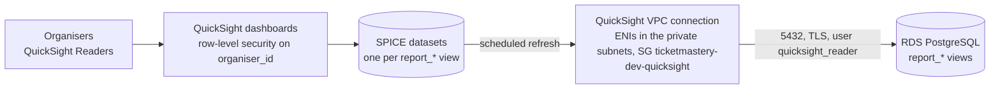

# UC5 internal reporting

Answers [instructor feedback e](architecture.md#instructor-feedback-open-items-not-implemented): organisers need
internal reporting and sales statistics, for example in QuickSight.

- **Built and tested:** the data layer. Five read-only SQL views in RDS
  ([`0003_uc5_reporting_views.sql`](../services/ticketmastery-api/migrations/0003_uc5_reporting_views.sql)), applied
  by the API's migration runner like every other migration, and checked row by row in
  [`test/reporting-views.test.ts`](../services/ticketmastery-api/test/reporting-views.test.ts) against orders made
  through the real organiser and checkout services.
- **Design only:** Amazon QuickSight (now sold as *Amazon Quick Sight*) on top of those views. It is not in
  Terraform and not subscribed, because it is billed per user per month (see [Why it is not deployed](#why-it-is-not-deployed)).

The live organiser dashboard (`GET /api/organiser/concerts/:id/dashboard`, polled every 5 s) stays the tool for
the on-sale moment. The views are for after-the-fact questions across concerts: how much did we sell, of what,
on which day.

## Reporting views

All views are plain (not materialised) views in the API's schema, so they are always current and need no refresh
job. Conventions shared by every view:

- **Sales = confirmed orders.** Pending, cancelled (released or payment declined) and expired checkout attempts
  are not sales.
- **Money is integer cents, as `bigint`, per currency.** An order has one currency, but a concert can have ticket
  types in different currencies, so every sales view groups by `currency` and never adds across currencies.
- **`organiser_id`** (the organiser's Cognito `sub`) is on every view, so a BI tool can apply row-level security.
- **Cancelled concerts keep their sales** (no refunds exist yet). Filter on `concert_status` to leave them out.
- **No buyer identities.** `fan_id` is not exposed; reporting doesn't need it.

| View | One row per | Columns |
|---|---|---|
| `report_confirmed_orders` | confirmed order | `order_id`, `concert_id`, `organiser_id`, `currency`, `seats`, `ticket_revenue_cents`, `booking_fee_cents`, `gross_revenue_cents`, `confirmed_at`, `sale_date_sgt` |
| `report_sales_by_concert` | concert × currency | `concert_id`, `organiser_id`, `concert_title`, `artist`, `venue_name`, `concert_starts_at`, `concert_status`, `currency`, `confirmed_orders`, `seats_sold`, `ticket_revenue_cents`, `booking_fee_cents`, `gross_revenue_cents` |
| `report_sales_by_ticket_type` | concert × ticket type × currency | `concert_id`, `organiser_id`, `concert_title`, `ticket_type_id`, `ticket_type_name`, `ticket_type_sort_order`, `currency`, `confirmed_orders`, `seats_sold`, `ticket_revenue_cents` |
| `report_sales_by_day` | Singapore day × concert × currency | `sale_date`, `concert_id`, `organiser_id`, `concert_title`, `currency`, `confirmed_orders`, `seats_sold`, `ticket_revenue_cents`, `booking_fee_cents`, `gross_revenue_cents` |
| `report_seat_status` | concert (every concert, drafts included) | `concert_id`, `organiser_id`, `concert_title`, `concert_starts_at`, `concert_status`, `available`, `held`, `sold`, `total` |

Definitions:

- `ticket_revenue_cents`: face value of the seats sold (`orders.subtotal_cents`, or the sum of the seat prices
  snapshotted at hold time in `order_items`).
- `booking_fee_cents`: the booking fee (S$4 per seat, charged per order). It is not split by ticket type, so
  `report_sales_by_ticket_type` has no fee column.
- `gross_revenue_cents`: what fans paid, ticket revenue plus booking fees (`orders.total_cents`).
- `sale_date` / `sale_date_sgt`: the calendar day in Singapore (`Asia/Singapore`, UTC+8) on which the payment was
  confirmed (`confirmed_at`), independent of the database session's time zone. A payment at 23:59:59 SGT counts on
  that day, one at 00:00:00 SGT on the next.
- `report_seat_status` uses the live dashboard's definitions (view `concert_seat_counts` in `0001`): a hold that
  has expired but not yet been released counts as `available`, because any checkout can take the seat at once, so
  `held` means active holds only. Counts are as of the query (in SPICE: as of the last refresh). Concerts without a
  layout show all zeros.

Example: one organiser's revenue per concert, in dollars.

```sql
SELECT concert_title, currency, seats_sold, gross_revenue_cents / 100.0 AS gross_revenue
  FROM report_sales_by_concert
 WHERE organiser_id = '<cognito sub>' AND concert_status <> 'cancelled'
 ORDER BY concert_starts_at, currency;
```

## QuickSight design (not deployed)



### Edition and account

- **Enterprise edition**, in `ap-southeast-1` next to RDS. Enterprise is required for everything below: VPC
  connections to a private database, row-level security and hourly refreshes. (Standard edition is now only
  offered through the `CreateAccountSubscription` API and has none of these.)
- Users: one **Author** (Elroy, also admin) builds datasets and dashboards. Organisers are **Readers**. No *Pro*
  users and no Q&A topics, because either one adds a USD 250/month account fee.

### Network: VPC connection to RDS

RDS has no public endpoint and sits in the private subnets, so QuickSight reaches it through a
[VPC connection](https://docs.aws.amazon.com/quick/latest/userguide/vpc-creating-a-connection-in-quicksight-cli.md),
which places QuickSight network interfaces in our VPC:

- **Subnets:** `private_subnet_ids` (the two private subnets, AZ a and AZ b; a VPC connection needs at least two).
  QuickSight's ENIs need no internet access, so the missing NAT gateway does not matter.
- **Security group** `ticketmastery-dev-quicksight` in the VPC: no inbound rules, one egress rule to the RDS
  security group on 5432. (AWS's extra "allow all inbound TCP from the database SG" rule applies only to VPC
  connections created before 27 April 2023;
  [security group rules](https://docs.aws.amazon.com/quick/latest/userguide/vpc-security-groups.md).)
- **RDS ingress:** add that security group's ID to the existing root variable `rds_extra_ingress_sg_ids`, which
  the `security` module turns into an inbound rule on the RDS SG for port 5432. No other change to the RDS module.
- **Execution role** trusted by `quicksight.amazonaws.com` with `ec2:CreateNetworkInterface`,
  `ec2:ModifyNetworkInterfaceAttribute`, `ec2:DeleteNetworkInterface`, `ec2:DescribeSubnets` and
  `ec2:DescribeSecurityGroups`, so QuickSight can manage its ENIs.

These pieces are Terraform resources (`aws_security_group`, `aws_iam_role`, `aws_quicksight_vpc_connection`,
`aws_quicksight_data_source`, `aws_quicksight_data_set`, `aws_quicksight_refresh_schedule`), so turning reporting
on later is a new `infra/modules/reporting` module plus one entry in `rds_extra_ingress_sg_ids`. The account
subscription and user invitations are console steps.

### Database user: read-only, views only

QuickSight connects as its own login, never the RDS master user. It can read the five views and nothing else:
PostgreSQL views run with their owner's privileges, so the reporting user needs no grant on `orders`, `seats` or
any other table, and cannot see fan ids or hold details.

```sql
-- Run once as the master user. Keep the password in Secrets Manager, not in git.
CREATE ROLE quicksight_reader LOGIN PASSWORD '<from Secrets Manager>';
ALTER ROLE quicksight_reader SET default_transaction_read_only = on;
ALTER ROLE quicksight_reader CONNECTION LIMIT 5;
GRANT CONNECT ON DATABASE ticketmastery TO quicksight_reader;
GRANT USAGE ON SCHEMA public TO quicksight_reader;
GRANT SELECT ON report_confirmed_orders, report_sales_by_concert, report_sales_by_ticket_type,
                report_sales_by_day, report_seat_status TO quicksight_reader;
```

This is not a migration on purpose: roles are cluster-wide (the tests' throwaway schemas would collide), a
migration must not carry a password, and the user is only needed once QuickSight exists.

The QuickSight data source is **PostgreSQL**, host = the RDS endpoint, database `ticketmastery`, **SSL on**
(PostgreSQL 16 on RDS enforces TLS by default), through the VPC connection above.

### Datasets and SPICE refresh

Each `report_*` view is one dataset, imported into **SPICE** rather than queried directly, so opening a dashboard
never adds load to the single `db.t4g.micro` that also serves checkout. The data is tiny (kilobytes per concert),
well inside the 10 GB of SPICE included with the Author.

| Dataset | Schedule (Asia/Singapore) | Why |
|---|---|---|
| `report_sales_by_concert`, `report_sales_by_ticket_type`, `report_sales_by_day`, `report_confirmed_orders` | **Hourly** (Enterprise only) while any concert is on sale; **daily at 02:00** otherwise | Sales questions are about trends, not seconds. Each refresh is a handful of aggregate queries. |
| `report_seat_status` | Hourly with the sales datasets | A snapshot for reports; the live API dashboard shows seconds-fresh counts. |

Hourly schedules can't be combined with other schedules on the same dataset, so switching between "on-sale" and
"quiet" means replacing the schedule (`aws_quicksight_refresh_schedule`, or the
[refresh schedule settings](https://docs.aws.amazon.com/quick/latest/userguide/refreshing-imported-data.md)).

### Dashboards for organisers

One dashboard, **Concert sales**, shared with the organisers' Reader accounts:

- **KPIs** per currency: gross revenue, ticket revenue, booking fees, seats sold, confirmed orders
  (`report_sales_by_concert`).
- **Sales per day** line chart, one line per concert (`report_sales_by_day`), with cumulative revenue.
- **Ticket mix** bar chart: seats sold and revenue per ticket type, sorted by `ticket_type_sort_order`
  (`report_sales_by_ticket_type`).
- **Inventory** stacked bar per concert: sold / held / available out of total (`report_seat_status`), to spot
  concerts that are slow to sell.
- Filters: concert, currency, concert status (default: hide cancelled), date range.

**Row-level security** keeps each organiser to their own concerts: a rules dataset maps each QuickSight user name
to the `organiser_id` (Cognito `sub`) it may see, applied to every dataset. The Author/admin account has no rule
restriction and sees all organisers.

## Cost

Prices from the [Amazon Quick Sight pricing page](https://aws.amazon.com/quick/quicksight/pricing/), checked
**31 October 2026** (USD, per month):

| Item | List price |
|---|---|
| Author | $24 per user/month (includes 10 GB SPICE) |
| Author Pro | $40 per user/month |
| Reader | $3 per user/month |
| Reader Pro | $20 per user/month |
| Account infrastructure fee | $250/month if the account has any Pro user or Q&A enabled |
| Reader capacity pricing | from $250/month for 500 sessions |
| Extra SPICE | $0.38 per GB/month |

Smallest useful setup (1 Author + 2 Readers, no Pro, no Q&A, SPICE inside the included 10 GB):

$$24 + 2 \times 3 = \text{USD } 30 \text{ per month}$$

The pricing page lists no charge for VPC connections, and the extra security group is free; the hourly SPICE
refreshes add a few seconds of RDS work per hour.

## Why it is not deployed

- **Per-user monthly billing.** QuickSight charges each user per month, not per use, so it costs the same whether
  anyone opens the dashboard or not.
- **The course budget is USD 80 in total**, and the base stack alone is about USD 69 per month if left running
  ([cost-estimate.md](cost-estimate.md)). The smallest QuickSight setup (USD 30 per month, USD 24 of it for the one
  Author) would take over a third of the whole budget; reader capacity pricing (USD 250 per month minimum) is out of
  reach.
- **The graded use case is covered without it.** Organisers already get live counts from the API dashboard, and
  the reporting data is real and tested: the views return the demo concert's sales and can be queried directly
  (`psql`, or the RDS Query Editor) for the report.
- **Switching it on is a console-and-Terraform step**, with no application change: subscribe to Enterprise, create
  the read-only user, add the VPC connection's SG to `rds_extra_ingress_sg_ids`, import the five views into SPICE
  and build the dashboard. Decided 2026-10-31 (see [plans/final-submission.md](plans/final-submission.md)).
